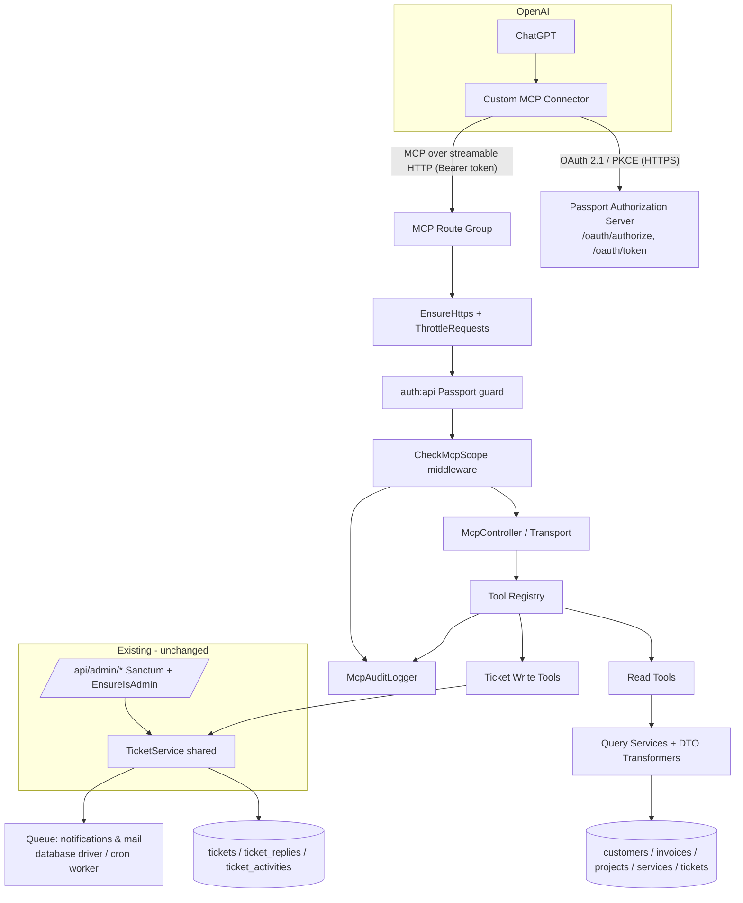
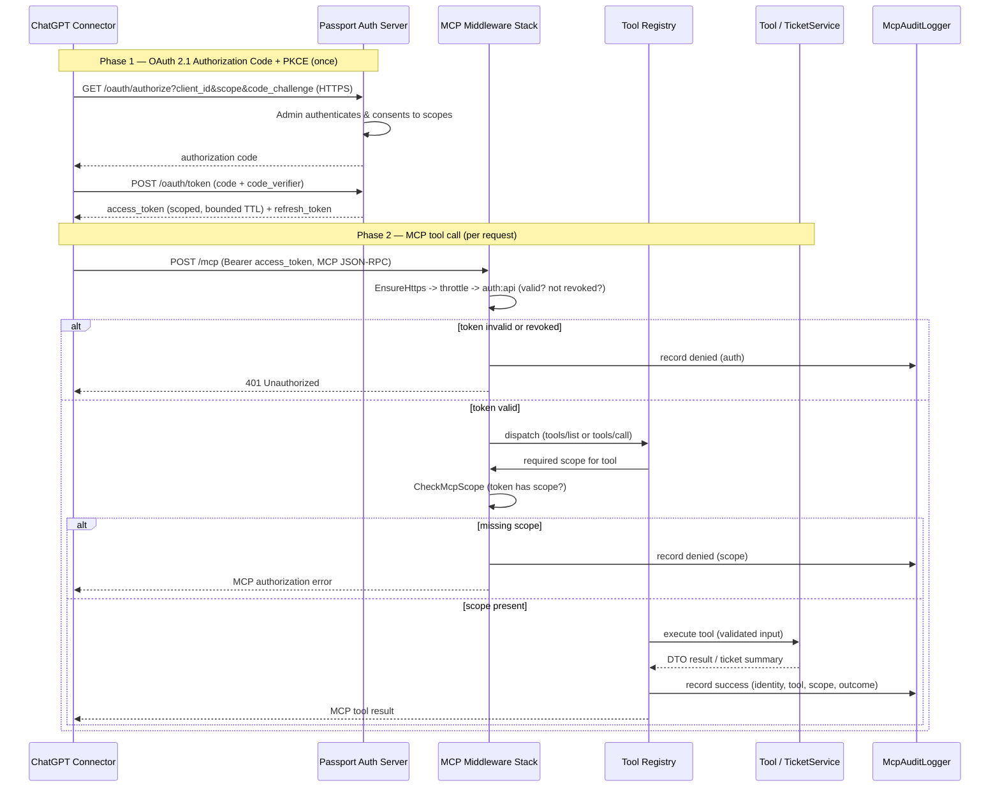

# Design Document: ChatGPT MCP Integration

## Overview

This feature adds a secure, remote **Model Context Protocol (MCP)** server to the existing CK CRM (Laravel 13 / PHP 8.3, hosted on cPanel) so that ChatGPT — through OpenAI's custom MCP connector — can **read** five CRM domains (Customers, Invoices, Projects, Services, Tickets) and **write** to Tickets only (create, update, reply).

The design is deliberately **additive**: it introduces a new route group, an OAuth 2.1 authorization server (Laravel Passport), a scope-checking middleware, an MCP transport layer, a tool registry, read/write tools, DTO transformers, an audit log, and a shared `TicketService`. It does **not** change the existing `/api/admin/*` Sanctum + `EnsureIsAdmin` flow (Req 14.1). The only refactor to existing code is extracting ticket write logic from `App\Http\Controllers\Api\Admin\TicketController` into a shared `TicketService` that both the admin controller and the MCP write tools call, preserving observable behaviour (Req 14.2).

Three design pillars address the requirements:

1. **Least privilege by scope, not by role.** Authorization derives solely from the OAuth scopes on the presented token, independent of `is_admin` (Req 2.1). The MCP identity is a dedicated Passport client that cannot log in to the web or Sanctum admin API (Req 2.5).
2. **Data minimisation by construction.** Every tool returns a hand-built DTO with an explicit field allow-list. Full Eloquent models are never serialised into responses, so security fields and third-party secrets cannot leak even if the model changes (Req 12).
3. **cPanel-compatible deployment.** The MCP server is a set of routes inside the existing app served over streamable HTTP — no long-lived stdio process, no SSH, compatible with cron-based queue draining (Req 14.3, 14.4).

### Key design decisions and rationale

| Decision | Rationale | Requirements |
| --- | --- | --- |
| Use **Laravel Passport** as the OAuth 2.1 authorization server | Requirements name Passport explicitly; Passport provides authorize + token endpoints, PKCE, refresh tokens, scopes, and token revocation out of the box. Sanctum (already present) issues opaque personal-access tokens and is not an OAuth authorization-code server, so it cannot satisfy the PKCE authorization-code flow OpenAI's connector needs. | 1.1, 1.2, 1.7 |
| Serve MCP over **streamable HTTP** inside the app | OpenAI's custom MCP connector supports remote HTTP transport. A stdio MCP server needs a long-lived local process, which cPanel cron hosting cannot keep running. | 14.3 |
| **Dedicated system/bot user row** for write attribution | `TicketActivity.user_id` and `TicketReply.user_id` are non-nullable FKs to `users.id` and the admin path uses `request->user()->id`. A bot user keeps those FKs valid and preserves `TicketActivity::getDescriptionAttribute()` behaviour, while a `is_login_disabled` flag + no password keeps it non-login. | 10.2, 11.5, 2.5 |
| **Explicit DTO transformers**, never `->toArray()` on models | Guarantees field exclusion regardless of future model/`$fillable` changes; `Service::show` in the admin API currently does `$service->toArray()` which would leak `cpanel_username`/`stripe_subscription_id` — the MCP surface must not repeat that. | 12.1, 12.2, 12.3 |
| **Scope-checking middleware** on the MCP route group | Centralises authorization so every tool is gated the same way and denials are audited uniformly. | 1.4, 2.1, 2.4 |

## Architecture

### High-level component view

The MCP server is a thin protocol/transport layer in front of a tool registry. Tools delegate reads to DTO-producing query services and writes to the shared `TicketService`. Authorization is enforced by middleware before any tool executes.



### Request / authorization flow

Two phases: a one-time OAuth authorization (admin consents, connector stores tokens) and per-call tool invocation.



### Middleware order (MCP route group)

Applied in this order so cheap/safe rejections happen first and every rejection is auditable:

1. `EnsureHttps` — reject non-HTTPS (Req 1.6). In production cPanel, TLS terminates at the web server; this middleware also honours `X-Forwarded-Proto` behind the proxy.
2. `throttle:mcp` — named rate limiter (Req 13.2).
3. `auth:api` — Passport access-token guard; rejects missing/expired/revoked tokens (Req 1.5, 1.7).
4. `CheckMcpScope` — per-tool scope enforcement (Req 1.4, 2.1, 2.4), writes denied-attempt audit entries (Req 13.4).

### Deployment considerations (cPanel)

- **Adding Passport.** `composer require laravel/passport` must be run where Composer is available. On cPanel without SSH, this is done either via the host's Composer UI/terminal, or by committing an updated `composer.lock` and running `composer install --no-dev` through the cPanel "Composer" tool, then `php artisan migrate --force` and `php artisan passport:keys` (or `passport:install`) via the cron/terminal facility. The generated Passport encryption keys (`storage/oauth-*.key`) must be deployed and kept out of version control. This is called out because the current `composer.json` includes `laravel/sanctum` but **not** `laravel/passport`.
- **No long-lived process.** The MCP server is request/response over HTTP; nothing needs `php artisan` running persistently.
- **Queue.** `QUEUE_CONNECTION=database` in `.env.example`. Notifications/mail from ticket writes are dispatched to the queue and drained by the existing cron-scheduled worker, so a write tool returns promptly and does not block on SMTP (Req 14.4). If the deployment runs the `sync` driver, behaviour is identical to the current admin API (inline send), which is acceptable because the admin path already behaves that way.

## Components and Interfaces

### 1. OAuth 2.1 Authorization Server (Laravel Passport)

- Install Passport; register the `Passport` routes (`/oauth/authorize`, `/oauth/token`, token management) and the `api` guard backed by `Passport::actingAs`/token guard in `config/auth.php` as a **new** guard — the existing `web` and `sanctum` guards are untouched (Req 14.1).
- **Scopes** registered via `Passport::tokensCan([...])` limited to the fixed set: `customers:read`, `invoices:read`, `projects:read`, `services:read`, `tickets:read`, `tickets:write` (Req 1.3).
- **PKCE public client** for the connector created with `php artisan passport:client --public` so no client secret is shipped to OpenAI (Req 1.2).
- **Token lifetimes** configured in the Passport service provider: short-lived access tokens (e.g. `Passport::tokensExpireIn(now()->addMinutes(60))`), refresh tokens bounded (e.g. 14 days), satisfying "bounded lifetime + refresh" (Req 1.7).
- **Revocation.** An admin-only screen/command lists issued MCP tokens and revokes them (`$token->revoke()` / delete the token + refresh token). The `auth:api` guard rejects revoked tokens on the next call (Req 1.5).
- Interface (admin-facing, inside existing admin area, not exposed to MCP):
  - `GET /admin/mcp/tokens` — list active MCP tokens (id, scopes, created, last_used, expires). No token values shown.
  - `POST /admin/mcp/tokens/{id}/revoke` — revoke.

### 2. MCP Identity (dedicated least-privilege client/user)

Two linked artefacts:

- **Passport client** (`mcp_client`) — the OAuth client ChatGPT uses. Authorization is based only on the scopes on its issued tokens (Req 2.1).
- **Bot user row** (`users` table) — a system actor used purely for FK attribution on ticket writes. It is created with:
  - `is_admin = false` (so it can never pass `EnsureIsAdmin`; authorization never consults `is_admin` anyway — Req 2.1),
  - a new `is_login_disabled = true` flag and **no usable password** (random/null hash), so it cannot authenticate to web or the Sanctum admin API (Req 2.5),
  - `email` like `mcp-bot@system.local` marked non-notifiable where relevant.

The bot user is resolved once (cached) and injected into `TicketService` as the actor for MCP-originated writes. The admin controller continues to pass `request->user()` (a real admin). See **Attribution** under Data Models.

### 3. MCP Route Group & Transport

- A new route group (outside the `admin` prefix, e.g. prefix `mcp`) in `routes/api.php` **appended** after the existing admin group so nothing above it changes (Req 14.1):

```php
Route::prefix('mcp')
    ->middleware([EnsureHttps::class, 'throttle:mcp', 'auth:api'])
    ->group(function () {
        Route::post('/', [McpController::class, 'handle']);       // JSON-RPC: initialize, tools/list, tools/call
        Route::get('/', [McpController::class, 'handleStream']);  // streamable HTTP (SSE) channel
    });
```

- **Transport: streamable HTTP.** `McpController` implements the MCP JSON-RPC methods the connector needs:
  - `initialize` — protocol handshake, returns server capabilities (Req 3.1).
  - `tools/list` — returns tool name, description, and JSON input schema **filtered to the scopes on the token** (Req 3.2, 3.3). Read tools are described distinctly from the three ticket write tools (Req 3.3).
  - `tools/call` — validates params against the tool's schema, runs `CheckMcpScope` for that tool's required scope, executes, audits, returns the MCP result or structured error.
  - Streaming responses use chunked/SSE transfer compatible with OpenAI's remote connector; because requests are short-lived HTTP they fit cron hosting (Req 14.3). A stdio transport is explicitly rejected.

### 4. Scope-Checking Middleware (`CheckMcpScope`)

- Resolves the tool being invoked (from the JSON-RPC `tools/call` params or the route→tool mapping) and looks up its **required scope** from the Tool Registry.
- If the token lacks the scope: write a denied audit entry (Req 13.4) and return an MCP authorization error without executing (Req 1.4, 2.4).
- Authorization reads only `$token->can($scope)` — never `is_admin` (Req 2.1).
- Any method/tool not in the registry is denied by default (Req 2.3, 2.4) — the registry is an allow-list, so no un-listed CRM operation (assets, shop, domains, billing, user management) is reachable (Req 2.2, 2.3).

### 5. Tool Registry

- Central allow-list mapping tool name → `{ description, inputSchema, requiredScope, handler }`.
- Single source of truth for `tools/list` (advertisement) and `tools/call` (dispatch), guaranteeing a tool is advertised iff the scope is present and is callable iff registered (Req 3.1–3.3, 2.3).
- Registered tools:

| Tool | Scope | Kind |
| --- | --- | --- |
| `get_customer` / `search_customers` | `customers:read` | read |
| `get_invoice` / `list_invoices` | `invoices:read` | read |
| `get_project` / `list_projects` | `projects:read` | read |
| `get_service` / `list_services` | `services:read` | read |
| `get_ticket` / `search_tickets` | `tickets:read` | read |
| `create_ticket` | `tickets:write` | write |
| `update_ticket` | `tickets:write` | write |
| `reply_ticket` | `tickets:write` | write |

### 6. Read Tools & Query Services (per domain)

Each read tool calls a query service that builds a query, applies filters, paginates with a **capped** page size (`min($requested, 100)` matching existing controllers — Req 4.3, 5.3, 6.4, 7.3, 8.4), and maps each row through a DTO transformer. No `->toArray()` on models.

- **Customers** (`customers:read`, Req 4): `get_customer(company_id)`, `search_customers(name, page, per_page)`. Returns `company_id, company_name, customer_name, phone_number, address_line1/2, city, state, postal_code, country`. The `users()` relation is **never** traversed into a response, so no user security field can appear (Req 4.4). `stripe_customer_id` is excluded (non-secret but not needed).
- **Invoices** (`invoices:read`, Req 5): `list_invoices(company_id?, invoice_status?, page, per_page)`, `get_invoice(invoice_id)`. Returns `invoice_id, company_id, invoice_status, invoice_amount, invoice_date, due_date, paid_date` and optional `stripe_hosted_url` (non-secret reference). **Excludes** `stripe_invoice_id` (Req 5.4). Applies `scopeCollectable` semantics as the default (excludes Void/Uncollectible/Deleted) matching the admin API.
- **Projects** (`projects:read`, Req 6 — no existing API, new read surface): `list_projects(company_id?, status?, page, per_page)`, `get_project(id)`. Returns `id, company_id, title, status, progress_percentage` (via `getProgressPercentageAttribute()`). `status` is constrained to `Project::STATUSES`.
- **Services** (`services:read`, Req 7): `list_services(company_id?, status?, page, per_page)`, `get_service(service_id)`. Returns `service_id, company_id, service_short, service_type, status, start_date, end_date`. **Never** returns `cpanel_username` or `stripe_subscription_id` (Req 7.4, 12.3).
- **Tickets** (`tickets:read`, Req 8): `search_tickets(status?, priority?, company_id?, search?, page, per_page)` returns summaries (`ticket_id, subject, status, priority, ticket_type, customer_name, company_id`); `get_ticket(ticket_id)` returns detail including `description`, customer/service/asset references, **both** internal and non-internal replies, and the activity history (Req 8.3). Reply/activity DTOs expose `user_name` (full name), never the user row.

### 7. Ticket Write Tools

Thin adapters over `TicketService`. They validate input against the tool schema (same rules as the admin path — Req 9.1, 10.1, 11.1), pass the **bot user** as actor, and return a compact result.

- `create_ticket` → `TicketService::create(array $data, User $actor, bool $notifyCustomer)`. Returns `ticket_id` + summary (Req 9.5).
- `update_ticket` → `TicketService::update(Ticket $ticket, array $data, User $actor)`.
- `reply_ticket` → `TicketService::reply(Ticket $ticket, array $data, User $actor)`.

On validation failure or missing ticket, the tool returns a structured MCP error listing invalid fields and performs no write (Req 9.2, 10.5).

### 8. Shared `TicketService`

Extracted from `App\Http\Controllers\Api\Admin\TicketController` **without behaviour change** (Req 14.2). The actor becomes an explicit parameter instead of `request->user()`.

```php
final class TicketService
{
    public function create(array $data, User $actor, bool $notifyCustomer): Ticket;
    public function update(Ticket $ticket, array $data, User $actor): Ticket;
    public function reply(Ticket $ticket, array $data, User $actor, bool $isInternal): TicketReply;
}
```

Preserved behaviour (verbatim mapping from the current controller):

- **create**: persists with `status = 'Open'`; if `notify_customer`, emails all non-admin company users (`emails.ticket-opened`); **always** `Notification::send(User::where('is_admin', true)->get(), new NewTicketNotification($ticket))` (Req 9.3, 9.4).
- **update**: validates `status ∈ {Open,Pending,In Progress,Closed}`, `priority ∈ {Low,Normal,High,Critical}`, `ticket_type ∈ {Incident,Service Request}`; diffs and writes `TicketActivity` rows (`status_changed`, `priority_changed`, `type_changed`, `assigned_changed`) attributed to `$actor->id` (Req 10.2); emails customer on status change (`emails.ticket-status-changed`, Req 10.3); if priority set to `Critical`, `Notification::send(admins, CriticalTicketNotification)` (Req 10.4).
- **reply**: validates `body` required + `is_internal` boolean; creates `TicketReply` attributed to `$actor->id`; sets `first_replied_at = now()` if unset and reply non-internal (Req 11.4); if ticket was `Closed`, reopen to `Open` and log a `status_changed` activity (Req 11.3); non-internal replies email customer (`emails.ticket-reply`), internal do not (Req 11.2, 11.5).

The admin `TicketController` is refactored to call `TicketService` with `request->user()`, keeping its JSON responses and status codes identical (Req 14.1, 14.2).

### 9. DTO / Transformers

- One transformer class per domain (e.g. `CustomerDto`, `InvoiceDto`, `ProjectDto`, `ServiceDto`, `TicketSummaryDto`, `TicketDetailDto`, `TicketReplyDto`, `TicketActivityDto`).
- Each exposes `fromModel(Model): array` returning a fixed associative array with an explicit field allow-list. No dynamic spreading of model attributes.
- This is the enforcement point for Req 12.1–12.3: security fields and third-party secrets are structurally absent from outputs.

### 10. Audit Logging (`McpAuditLogger`)

- Writes an `mcp_audit_logs` row for **every** tool call and every denied authorization attempt (Req 13.1, 13.4).
- Records: token/client reference (Passport token id, not the token value), MCP identity, tool name, scope used/required, timestamp, outcome (`success`/`denied`/`error`), and a short reason for denials.
- **Does not** record security fields or full request payloads; only non-sensitive metadata (e.g. target `ticket_id`, `company_id` filter) is stored (Req 13.3).

### 11. Rate Limiting

- Named limiter `mcp` registered in a service provider (e.g. per-token: 60/min, configurable).
- Exceeding the limit returns Laravel's standard `429 Too Many Requests` with `Retry-After` / `X-RateLimit-*` headers (Req 13.2).

## Data Models

### New tables

**Passport OAuth tables** (created by Passport's migrations): `oauth_auth_codes`, `oauth_access_tokens`, `oauth_refresh_tokens`, `oauth_clients`, `oauth_personal_access_clients` (Laravel 13 / Passport current schema). These store clients, issued access/refresh tokens, scopes, and revocation flags — backing Req 1.1–1.3, 1.5, 1.7. No change to existing tables.

**`mcp_audit_logs`** (new) — Req 13:

| Column | Type | Notes |
| --- | --- | --- |
| `id` | bigint PK | |
| `access_token_id` | string, nullable | Passport token id reference (never the token value) |
| `mcp_identity` | string | client name / bot user reference |
| `tool_name` | string, nullable | null when denial happens before tool resolution |
| `scope_used` | string, nullable | scope required/checked |
| `outcome` | enum(`success`,`denied`,`error`) | |
| `reason` | string, nullable | denial/error reason, no sensitive data |
| `context` | json, nullable | non-sensitive metadata only (e.g. `ticket_id`, filters) |
| `created_at` | timestamp | invocation time |

Model: `McpAuditLog` with `$fillable` limited to the above and no sensitive casts. A purge command (reusing the existing `PurgeWebhookEventsCommand` pattern) can trim old rows via cron.

### Attribution approach (write provenance)

**Problem.** `ticket_activities.user_id` and `ticket_replies.user_id` are non-nullable FKs to `users.id`; the admin path uses `request->user()->id`. The MCP identity is not a real admin user, and `TicketActivity::getDescriptionAttribute()` renders `$this->user?->full_name` (falling back to "System").

**Chosen approach — dedicated system/bot user + source column.**

1. **Bot user row** in `users`: `first_name = 'MCP'`, `last_name = 'Assistant'` (so activity descriptions read "MCP Assistant changed status..."), `is_admin = false`, `is_login_disabled = true`, no usable password. This keeps the FKs valid and preserves existing rendering without special-casing nullable actors.
2. **Migration — add `is_login_disabled`** boolean (default `false`) to `users`; the login/auth paths (web + Sanctum `AuthController::login`) must reject users where `is_login_disabled = true`. This is the one change to an existing table and the one behavioural guard added to login, satisfying Req 2.5 (the bot cannot log in). It is a guarded/non-fillable attribute like `is_admin`.
3. **Optional `source` column on writes** — add nullable `source` (`'admin'` | `'mcp'`) to `ticket_replies` and `ticket_activities` so MCP-originated writes are distinguishable in audits. `TicketService` sets `source` from the actor context. This is additive and nullable, so existing admin writes (source `'admin'`/null) are unaffected (Req 14.2).

**Rejected alternative.** Making `user_id` nullable with a free-text actor label would weaken the FK, break `getDescriptionAttribute()`'s relation load, and require touching every read that joins the user — more invasive and riskier to admin behaviour. The bot-user approach is cleaner and keeps attribution a real, queryable relation.

### Existing models referenced (unchanged except as noted)

- **Customer** (PK `company_id`) — expose address/contact fields; never traverse `users()` into output.
- **Invoice** (PK `invoice_id`) — `scopeCollectable` default; expose `stripe_hosted_url` (non-secret), exclude `stripe_invoice_id`.
- **Project** (PK `id`) — expose `progress_percentage` accessor; `status ∈ STATUSES`.
- **Service** (PK `service_id`) — exclude `cpanel_username`, `stripe_subscription_id`.
- **Ticket** (PK `ticket_id`) + **TicketReply**, **TicketActivity** — write targets via `TicketService`; `source` column added (above).
- **User** — gains `is_login_disabled`; `$hidden` already excludes `password`, `remember_token`.

## Correctness Properties

*A property is a characteristic or behavior that should hold true across all valid executions of a system — essentially, a formal statement about what the system should do. Properties serve as the bridge between human-readable specifications and machine-verifiable correctness guarantees.*

These properties were derived from the acceptance-criteria prework analysis and consolidated to remove redundancy (e.g. field-presence and security-exclusion are combined into one DTO property; the several authorization criteria are combined into one scope-enforcement property; the ticket write side-effect criteria are combined into one model-based parity property against the existing admin controller).

### Property 1: Scope enforcement is the sole authorization gate

*For any* registered tool and *any* token scope set and *any* `is_admin` value on any associated user, the MCP server permits the tool call **if and only if** the tool is registered and the token carries that tool's required scope; the decision never depends on `is_admin`, and a denied call executes no read or write side effect.

**Validates: Requirements 1.4, 2.1, 2.2, 2.3, 2.4**

### Property 2: Tool advertisement matches token scopes

*For any* token scope set, the set of tools returned by `tools/list` equals exactly the set of registered tools whose required scope is present in that set, and every advertised tool carries a non-empty name, a description, and a valid input schema.

**Validates: Requirements 3.1, 3.2**

### Property 3: Issued token scopes are minimal and in-set

*For any* requested combination of scopes, an issued access token's scopes equal the intersection of the requested scopes with the allowed set {`customers:read`, `invoices:read`, `projects:read`, `services:read`, `tickets:read`, `tickets:write`} and contain no scope outside that set.

**Validates: Requirements 1.3**

### Property 4: Tool output contains exactly the allow-listed fields and no security field

*For any* domain record (with sensitive attributes populated) passed through any read tool's DTO transformer, the resulting output's keys are a subset of that tool's explicitly defined field allow-list, and the output (recursively, including nested replies/activities) contains none of the forbidden keys or values: `password`, `remember_token`, password-reset tokens, API tokens, MFA/session secrets, `cpanel_username`, `stripe_subscription_id`, `stripe_invoice_id`, and any WHM/cPanel/Stripe secret.

**Validates: Requirements 4.1, 4.4, 5.1, 6.2, 7.1, 7.4, 8.1, 8.3, 12.1, 12.2, 12.3**

### Property 5: Filtered reads return only matching records

*For any* read tool invoked with a `company_id` and/or status/priority filter over any generated dataset, every record in the result satisfies all supplied filter predicates.

**Validates: Requirements 4.2, 5.2, 6.3, 7.2, 8.2**

### Property 6: Pagination page size is capped

*For any* list/read tool and *any* requested `per_page` value (including values greater than 100, zero, or negative), the effective page size is `min(requested, 100)` bounded to a positive value, and the number of records returned in a page never exceeds that effective size.

**Validates: Requirements 4.3, 5.3, 6.4, 7.3, 8.4**

### Property 7: Write validation parity and no-mutation-on-invalid

*For any* generated create/update/reply payload, the MCP write tool accepts the payload if and only if the existing admin ticket validation rules accept it; and whenever the payload is rejected, a structured error naming the offending fields is returned and the database state (tickets, replies, activities) is unchanged.

**Validates: Requirements 9.1, 9.2, 10.1, 10.5, 11.1**

### Property 8: Write side-effect parity with the admin controller (model-based)

*For any* valid create/update/reply operation, applying it through the MCP write tool produces the same observable outcome as applying the same operation through the existing admin `TicketController` — identical resulting ticket state, identical set of `TicketActivity` rows (types and old/new values), identical `first_replied_at` and reopen-on-closed behaviour, and the identical set of dispatched notifications/emails (`NewTicketNotification`, `CriticalTicketNotification`, `emails.ticket-opened`, `emails.ticket-status-changed`, `emails.ticket-reply`) — differing only in the recorded actor (MCP bot user vs admin) and the `source` column; and a successful create returns the persisted `ticket_id`.

**Validates: Requirements 9.3, 9.4, 9.5, 10.2, 10.3, 10.4, 11.2, 11.3, 11.4, 11.5, 14.2**

### Property 9: Audit completeness

*For any* sequence of tool calls (authorized successes, execution errors, and authorization denials), the MCP server writes exactly one `mcp_audit_logs` row per call, and each row's `outcome`, `tool_name` (when the tool was resolved), `scope_used`, identity reference, and timestamp match that call.

**Validates: Requirements 13.1, 13.4**

### Property 10: Audit content safety

*For any* tool call whose input contains sensitive values, the written `mcp_audit_logs` row contains none of the forbidden security keys/values and does not store the full request payload — only non-sensitive metadata.

**Validates: Requirements 13.3**

## Error Handling

All MCP errors are returned as structured MCP/JSON-RPC error responses (never raw stack traces), and every failure path is audited.

| Condition | Response | Requirements |
| --- | --- | --- |
| Non-HTTPS request | Reject at `EnsureHttps` before auth; connection/`403` with no body leakage | 1.6 |
| Missing/expired/revoked token | `401 Unauthorized` via `auth:api`; audited as `denied` | 1.5, 1.7, 13.4 |
| Missing required scope | MCP authorization error (JSON-RPC error, not a tool result); no execution; audited as `denied` | 1.4, 2.1, 2.4, 13.4 |
| Unknown/unregistered tool | MCP method/tool-not-found error; default-deny; audited as `denied` | 2.3, 2.4 |
| Input validation failure (write) | Structured error listing invalid fields; no DB mutation; audited as `error` | 9.2, 10.5, 11.1 |
| Target ticket not found (update/reply) | Structured not-found error; no mutation; audited as `error` | 10.5 |
| Rate limit exceeded | `429 Too Many Requests` with `Retry-After` / `X-RateLimit-*` | 13.2 |
| Notification/email failure during a write | Swallowed exactly as the current controller does (`try/catch` around `Mail::send`) so the write still succeeds and does not block; dispatched via queue where configured | 14.4 |
| Unexpected server error | Generic MCP error without sensitive detail; audited as `error` | 12.1, 13.3 |

Validation errors preserve the field-level messages Laravel's validator already produces for the admin path, so the error shape is parity-consistent (Req 9.1, 10.1).

## Testing Strategy

A dual approach: **property-based tests** for the universal properties above and **example/integration tests** for configuration, infrastructure, and wording.

### Property-based testing

- **Library:** use a PHP property-based testing library layered on PHPUnit — **`innmind/black-box`** (native PHP generators/shrinking) or PHPUnit data-provider-driven generation. Do **not** hand-roll a PBT engine.
- **Iterations:** each property test runs a minimum of **100 generated cases**.
- **Tagging:** each property test is tagged with a comment referencing its design property, format: `// Feature: chatgpt-mcp-integration, Property {number}: {property_text}`.
- **One property → one property-based test**, mapped as:
  - Property 1 → scope-enforcement test: random `(toolName, tokenScopes, is_admin)`; assert permit ⇔ (registered ∧ scope present), handler not invoked on deny.
  - Property 2 → advertisement test: random scope subsets; assert advertised set equals scope-matched tools and each has name/description/schema.
  - Property 3 → token-minimality test: random requested-scope lists incl. junk; assert issued scopes = requested ∩ allowed.
  - Property 4 → DTO safety test: generate models with populated sensitive fields; run every read DTO; assert keys ⊆ allow-list and ∩ forbidden-set = ∅ (recursive).
  - Property 5 → filter test: random datasets + filters; assert all results satisfy filters.
  - Property 6 → pagination-cap test: random `per_page` incl. >100/0/negative across all five domains; assert effective ≤ 100 and page length ≤ effective.
  - Property 7 → validation-parity test: random payloads; assert MCP-accept ⇔ admin-rules-accept; on reject, DB unchanged + error names fields.
  - Property 8 → **model-based** parity test: `Notification::fake()` + `Mail::fake()`; apply the same op via admin controller (reference model) and via `TicketService` (MCP actor); assert equal ticket state, equal activity rows (modulo actor/source), equal faked notifications/mails.
  - Property 9 → audit-completeness test: random call sequences; assert one audit row per call with matching outcome.
  - Property 10 → audit-safety test: payloads carrying sensitive values; assert stored context excludes forbidden keys and full payload.

### Example / integration / smoke tests

- **OAuth flow (1.1, 1.2, 1.5, 1.7):** integration tests for authorize+token with PKCE, refresh, revocation (revoked → `401`); smoke test asserting bounded TTL + refresh configured.
- **HTTPS enforcement (1.6):** example test — http rejected, https allowed (honouring `X-Forwarded-Proto`).
- **Non-login bot identity (2.5):** example tests — bot user cannot log in to web or Sanctum admin API; `is_login_disabled` guard rejects it.
- **Tool descriptions (3.3):** example/snapshot assertions distinguishing read vs write tool descriptions.
- **Rate limiting (13.2):** integration test firing limit+1 requests; assert final `429` with headers.
- **Queue behaviour (14.4):** `Queue::fake()` write test — notifications dispatched, tool returns the ticket without blocking.
- **Non-disruption (14.1):** the existing admin `TicketController` test suite must pass unchanged after the `TicketService` extraction; add a regression test asserting admin JSON responses/status codes are byte-for-byte unchanged.
- **Deployment (14.3):** documented manual verification that MCP routes are request/response only (no persistent process); covered in `DEPLOYMENT.md`.

### Unit tests (focused)

- `TicketService` branch coverage for the specific examples the parity property generalises: reopen-on-closed, `first_replied_at` set-once, internal-vs-non-internal email gating, Critical→admin notification, each `TicketActivity` type.
- DTO transformers: concrete example assertions per domain for the exact expected key set.

Property tests cover the broad input space; example/unit tests pin specific behaviours and infrastructure wiring.

## Requirements Coverage Map

| Requirement | Covered by (design section) |
| --- | --- |
| 1.1–1.7 OAuth 2.1 / Passport | Components §1 (OAuth server), Architecture (flow, deployment), Data Models (Passport tables), Properties 3 |
| 2.1–2.5 Least-privilege identity | Components §2, §4 (scope middleware), Data Models (bot user, `is_login_disabled`), Property 1 |
| 3.1–3.3 Tool discovery | Components §3 (transport), §5 (registry), Property 2 |
| 4.x Read Customers | Components §6, Properties 4, 5, 6 |
| 5.x Read Invoices | Components §6, Properties 4, 5, 6 |
| 6.x Read Projects | Components §6 (new read surface), Properties 4, 5, 6 |
| 7.x Read Services | Components §6, Properties 4, 5, 6 |
| 8.x Read Tickets | Components §6, Properties 4, 5, 6 |
| 9.x Create Ticket | Components §7, §8 (TicketService), Properties 7, 8 |
| 10.x Update Ticket | Components §7, §8, Properties 7, 8 |
| 11.x Reply Ticket | Components §7, §8, Properties 7, 8 |
| 12.x Security exclusion | Components §9 (DTOs), Property 4 |
| 13.x Audit/rate limit | Components §10, §11, Data Models (`mcp_audit_logs`), Properties 9, 10 |
| 14.x Non-disruption | Overview, Components §8, Architecture (deployment/queue), Testing (non-disruption), Property 8 |
