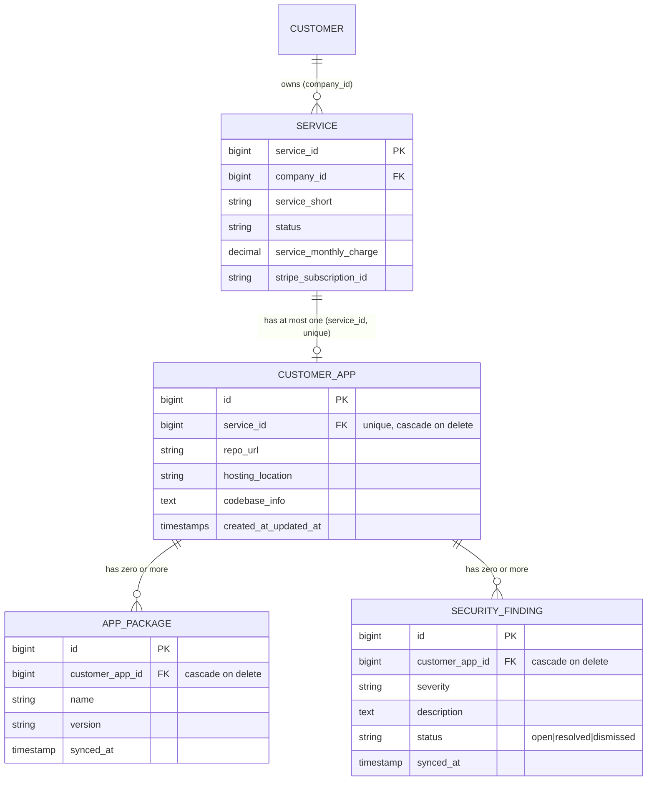
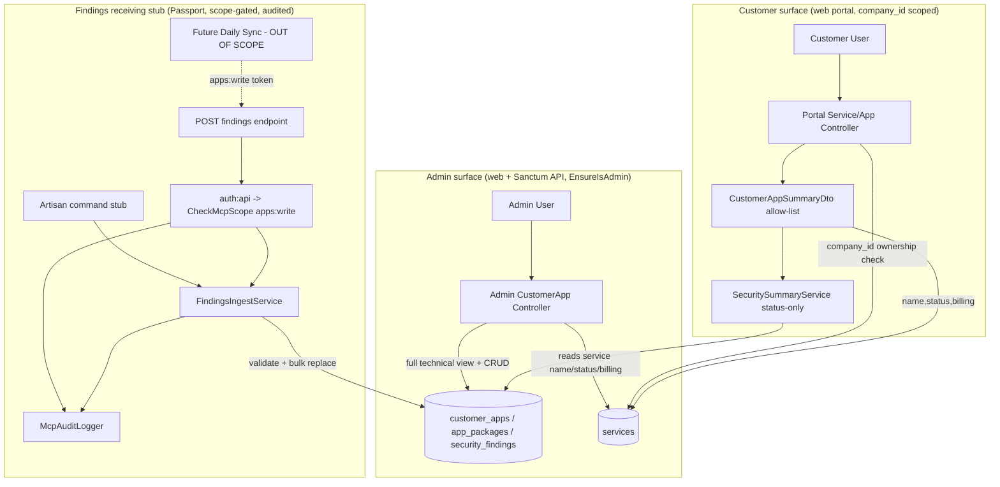
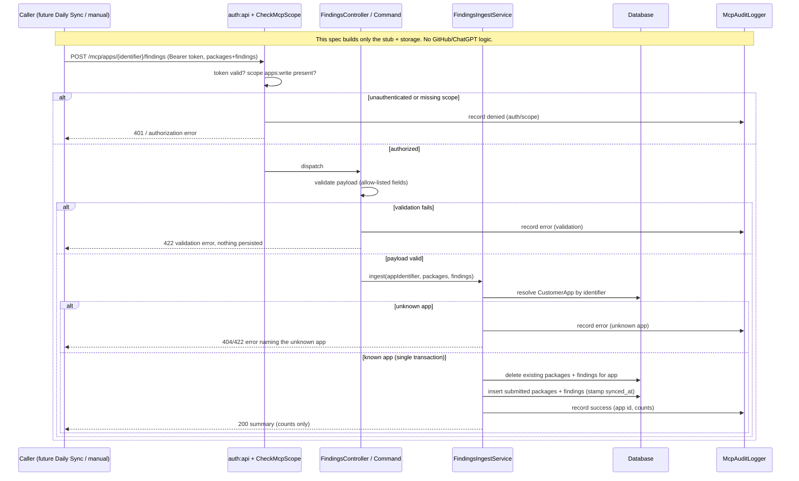

# Design Document: Customer App Services

## Overview

This feature adds **managed customer applications** ("apps") to the CK CRM (Laravel 13 / PHP 8.3, cPanel hosting). An app is a bespoke product CK Enterprises builds, hosts, and maintains for a customer. Billing and the customer-facing identity of an app already live on the existing `App\Models\Service` record (free, or linked to Stripe via `stripe_subscription_id`). This spec adds a **separate technical record** — `App\Models\CustomerApp`, one-to-one with `Service` on `service_id` — that holds the metadata which must never reach the customer: git repository URL, hosting/storage location, codebase information, installed packages, and security findings.

The design is deliberately **additive and thin**. It introduces three tables (`customer_apps`, `app_packages`, `security_findings`), their Eloquent models and relationships, a cascade-delete path from `Service`, an admin technical view, a customer portal summary view, and a **receiving endpoint/command stub** that accepts packages and findings for one identified app. The stub is where a future **daily sync** (a ChatGPT-to-GitHub scan, tracked separately) will deliver its results — but this spec builds **only the stub and its storage**. No GitHub, ChatGPT, or OpenAI scanning logic is written here.

Three pillars carry the requirements:

1. **Separation of billing from technical metadata.** `CustomerApp` never duplicates billing fields; it defers to `Service` for everything a customer or invoice sees (Req 1.5). The technical record exists purely to hold data the customer must not see.
2. **Data minimisation by construction, borrowed from `chatgpt-mcp-integration`.** The customer surface returns a hand-built, allow-listed DTO — never `$model->toArray()`. Technical fields and vulnerability detail are structurally absent from customer output, and the security summary is derived solely from finding *status* (Req 5, Req 6).
3. **MCP-aligned receiving endpoint.** The findings stub authenticates with the same Passport OAuth 2.1 scope-gated scheme, applies DTO/validation allow-lists, and audits every call exactly like the MCP integration — so the later daily sync authenticates and is governed identically (Req 3).

### Key design decisions and rationale

| Decision | Rationale | Requirements |
| --- | --- | --- |
| **Dedicated `customer_apps` table 1:1 with `Service`**, no billing columns | Keeps technical metadata physically separate from the customer/billing record so a customer-facing read of `Service` can never touch repo/hosting/codebase. Billing stays single-sourced on `Service`. | 1.1, 1.2, 1.5 |
| **Unique index on `customer_apps.service_id`** | Enforces the "at most one CustomerApp per Service" invariant at the database level, so the admin create path's duplicate rejection cannot be bypassed by a race. | 1.3, 1.4 |
| **`service_id` FK with `onDelete('cascade')`**, and `customer_app_id` FKs on child tables also cascading | Deleting a `Service` must leave no orphaned technical rows. A single DB-level cascade chain (`services → customer_apps → app_packages / security_findings`) guarantees this without application bookkeeping. | 1.6 |
| **Separate `app_packages` and `security_findings` child tables** (not JSON columns) | A future daily sync must *bulk replace* an app's records in one operation. Row-per-record with a `customer_app_id` FK supports an atomic delete-then-insert replace and queryable findings for the summary, with no schema change when the sync lands. | 2.1, 2.2, 2.4, 2.5 |
| **`synced_at` timestamp on each child row** | Records when the Findings_Endpoint last wrote the record, distinct from Eloquent `created_at/updated_at`, so the admin view can show provenance and the later sync has a defined field to stamp. | 2.3 |
| **Findings stub reuses the MCP Passport guard + scope middleware + audit logger** | Requirement 3.5/3.7 mandates the MCP scheme. Reusing `auth:api` + `CheckMcpScope` + `McpAuditLogger` means the daily sync authenticates the same way with zero new auth surface, and every accept/reject is audited uniformly. | 3.5, 3.7 |
| **New scope `apps:write`** added to the MCP allowed-scope set | The endpoint is a *write* surface distinct from the read scopes; a dedicated scope lets a daily-sync token carry only `apps:write` (least privilege) without read access to other domains. | 3.5 |
| **Explicit `CustomerAppSummaryDto`** for the portal, never model serialisation | Mirrors the MCP `ServiceDto` discipline. The existing `Api\Admin\ServiceController::show` does `$service->toArray()` — that leak must **not** be repeated on the customer surface, where exposure of repo/hosting/packages would be a direct breach of Req 5.3. | 5.3, 5.4 |
| **Security summary derived only from `status`** | The summary counts findings whose status is "open" and emits a fixed wording. Severity, description, and package names are never read into the summary path, so they cannot leak through it. | 6.1, 6.2, 6.3 |
| **Admin view reuses `Admin\ServiceController` (web/Blade) + `Api\Admin\ServiceController` (JSON) patterns** | Keeps the admin surface consistent with the existing service CRUD: resourceful controller methods, `Service` route-model binding, `admin.*` Blade views, and the capped-pagination JSON shape. | 4.4 |
| **Portal view reuses `Portal\ServiceController::show` pattern** | The existing portal show already enforces `company_id` ownership with `abort(403)` and renders a minimal Blade view — the app summary slots directly into that pattern. | 5.5, 5.6 |

## Architecture

### Data model



`Service` keeps its existing primary key `service_id` and `company_id` ownership. `CustomerApp` hangs off it one-to-one; the two child tables hang off `CustomerApp`. Every FK below `services` cascades on delete, so removing a `Service` removes the whole technical subtree (Req 1.6). No billing column appears on any new table (Req 1.5).

### Request flows



### Findings ingestion flow (per request)



### Deployment considerations (cPanel)

- **Migrations.** Three additive `create_*` migrations plus the FK cascade; run via `php artisan migrate --force` through the cPanel cron/terminal facility. No existing table is altered.
- **Passport dependency.** The findings endpoint depends on the `auth:api` Passport guard, the `apps:write` scope registration, and `CheckMcpScope`/`McpAuditLogger` introduced by `chatgpt-mcp-integration`. This spec **assumes those are present** (it is a sibling to that spec) and only adds the new scope string and the new route; it does not re-implement OAuth.
- **No long-lived process.** The endpoint is request/response HTTP and the Artisan command is a one-shot invocation — both fit cron hosting. The daily sync that would call either is out of scope.

## Components and Interfaces

### 1. Migrations

Three additive migrations following the repo's `database/migrations/<timestamp>_create_*_table.php` convention.

- **`create_customer_apps_table`**
  - `id` (bigint PK), `service_id` (bigint, FK → `services.service_id`, **unique**, `onDelete('cascade')`), `repo_url` (string, nullable), `hosting_location` (string, nullable), `codebase_info` (text, nullable), `timestamps`.
  - The unique index on `service_id` enforces one-to-one (Req 1.3). No billing columns (Req 1.5).
- **`create_app_packages_table`**
  - `id` (bigint PK), `customer_app_id` (bigint, FK → `customer_apps.id`, `onDelete('cascade')`), `name` (string), `version` (string), `synced_at` (timestamp, nullable), `timestamps`.
- **`create_security_findings_table`**
  - `id` (bigint PK), `customer_app_id` (bigint, FK → `customer_apps.id`, `onDelete('cascade')`), `severity` (string), `description` (text), `status` (string, default `'open'`), `synced_at` (timestamp, nullable), `timestamps`.
  - `status` is constrained in the application layer to a defined set (see model) rather than a DB enum, matching the string-status convention used across existing models (e.g. `Service.status`).

### 2. Eloquent models

**`App\Models\CustomerApp`**

```php
final class CustomerApp extends Model
{
    use HasFactory;

    protected $fillable = ['service_id', 'repo_url', 'hosting_location', 'codebase_info'];

    public function service(): BelongsTo
    {
        return $this->belongsTo(Service::class, 'service_id', 'service_id');
    }

    public function packages(): HasMany
    {
        return $this->hasMany(AppPackage::class);
    }

    public function findings(): HasMany
    {
        return $this->hasMany(SecurityFinding::class);
    }

    public function openFindings(): HasMany
    {
        return $this->findings()->where('status', SecurityFinding::STATUS_OPEN);
    }
}
```

**`App\Models\AppPackage`** — `$fillable = ['customer_app_id', 'name', 'version', 'synced_at']`; `synced_at` cast to `datetime`; `belongsTo(CustomerApp::class)`.

**`App\Models\SecurityFinding`** — `$fillable = ['customer_app_id', 'severity', 'description', 'status', 'synced_at']`; `synced_at` cast to `datetime`; `belongsTo(CustomerApp::class)`. Defines the status set:

```php
public const STATUS_OPEN = 'open';
public const STATUS_RESOLVED = 'resolved';
public const STATUS_DISMISSED = 'dismissed';
public const STATUSES = [self::STATUS_OPEN, self::STATUS_RESOLVED, self::STATUS_DISMISSED];
```

Only `STATUS_OPEN` is counted by the security summary; `resolved` and `dismissed` are "not open" (Req 6).

**`App\Models\Service` (one additive change)** — add the inverse one-to-one relationship so `Service` exposes at most one `CustomerApp` (Req 1.3). No other change; `$fillable`/`$casts` untouched.

```php
public function customerApp(): HasOne
{
    return $this->hasOne(CustomerApp::class, 'service_id', 'service_id');
}
```

### 3. Admin technical view (reuses `Admin\ServiceController` + `Api\Admin\ServiceController` patterns) — Req 4

A resourceful **`App\Http\Controllers\Admin\CustomerAppController`** (web/Blade) mirroring `Admin\ServiceController`: `Service`/`CustomerApp` route-model binding, `admin.customer-apps.*` Blade views, redirect-with-flash on write, guarded by the existing admin middleware group.

- **`create(Service $service)` / `store(Request, Service $service)`** — builds a `CustomerApp` against an existing `Service` (Req 4.2). Before insert, reject if the service already has one (Req 1.4): `if ($service->customerApp()->exists()) return back()->with('error', 'This service already has a linked app.')`. The DB unique index is the backstop. Validates `repo_url` (nullable URL), `hosting_location` (nullable string), `codebase_info` (nullable string).
- **`show(CustomerApp $customerApp)`** — eager-loads `service.customer`, `packages`, `findings` and renders the **full** technical view: repo URL, hosting location, codebase info, every package, every finding (Req 4.1), plus the linked service's name, status, and billing read from the `Service` record (Req 4.3). This is the admin surface, so full detail is intended here — the DTO allow-list applies only to the customer surface.
- **`edit` / `update(Request, CustomerApp $customerApp)`** — edits `repo_url`, `hosting_location`, `codebase_info` only (Req 4.2); billing and service identity stay on `Service`.

A parallel **`App\Http\Controllers\Api\Admin\CustomerAppController`** follows the `Api\Admin\ServiceController` JSON shape (`{ data, meta }`, `min($perPage, 100)` cap) for programmatic admin access. Unlike that controller's `show()`, it builds an **explicit array** rather than `$model->toArray()`, avoiding the leak pattern noted in the MCP design — even on the admin API, explicit field lists are the house style going forward.

### 4. Customer portal view & data minimisation (reuses `Portal\ServiceController` pattern) — Req 5

The customer already reaches an app through `Portal\ServiceController::show`, which enforces `company_id` ownership with `abort(403)` and renders `portal.services.show`. The app summary attaches to that same surface:

- **Ownership scoping (Req 5.5).** Reuse the exact guard already in `Portal\ServiceController::show`: `if ($service->company_id !== $request->user()->company_id) abort(403);`. Access is granted iff the service's `company_id` matches the requester's.
- **Allow-listed DTO (Req 5.1, 5.3, 5.4).** A dedicated transformer **`App\Support\Dto\CustomerAppSummaryDto`** with a single `fromService(Service $service): array` method returns a fixed associative array and nothing else:

```php
final class CustomerAppSummaryDto
{
    public static function fromService(Service $service): array
    {
        return [
            'name'            => $service->service_short,
            'status'          => $service->status,
            'billing'         => self::billing($service),           // 'Free' or formatted Stripe charge
            'security_summary'=> SecuritySummaryService::for($service->customerApp),
        ];
    }
}
```

The DTO reads only from `Service` (name, status, billing) and the derived summary. It never touches `CustomerApp->repo_url`, `hosting_location`, `codebase_info`, `packages`, or `findings` detail. Full-model serialisation (`toArray()`) is never used on the customer path, so repo URLs, hosting locations, codebase info, package names, and individual vulnerability detail are **structurally absent** from customer output (Req 5.3).

- **Billing (Req 5.1).** Derived from the `Service` record: when there is no `stripe_subscription_id` and no `service_monthly_charge`, report `Free`; otherwise report the formatted charge/frequency already stored on `Service`. Billing is never duplicated onto `CustomerApp` (Req 1.5).

The Blade view renders only the four DTO keys. No technical field has a template slot.

### 5. Security summary derivation — Req 6

**`App\Support\SecuritySummaryService`** produces the customer-safe string from finding **status alone**:

```php
final class SecuritySummaryService
{
    public static function for(?CustomerApp $app): string
    {
        $openCount = $app ? $app->openFindings()->count() : 0;

        if ($openCount === 0) {
            return 'Security checks passing';
        }

        return $openCount === 1
            ? '1 issue being addressed'
            : "{$openCount} issues being addressed";
    }
}
```

- No open findings (or no app) → "Security checks passing" (Req 6.1).
- One or more open findings → the count being addressed, naming no finding (Req 6.2).
- The count comes **solely** from `status === 'open'`; `severity`, `description`, and package records are never read in this path, so the summary string can contain no severity label, description, or package reference (Req 6.3).

### 6. Findings receiving endpoint & command stub — Req 3

Two entry points share one service; **neither contains any GitHub/ChatGPT/OpenAI logic** (Req 3.6):

- **HTTP endpoint** — `POST /mcp/apps/{identifier}/findings`, appended to the MCP route group so it inherits `EnsureHttps`, throttle, `auth:api` (Passport), and `CheckMcpScope`. Handled by **`App\Http\Controllers\Api\FindingsController`**, gated on the new scope **`apps:write`** (Req 3.5). The `{identifier}` is the app identifier the later sync will know (the `CustomerApp` id, or `service_id`); resolution failure is the "unknown app" path.
- **Artisan command stub** — `App\Console\Commands\IngestAppFindings` (signature e.g. `apps:ingest-findings {app} {--file=}`), following the `StripeSyncInvoices` command shape (begin/complete logging, summary counts). It exists so the future daily sync — or a manual operator — can push a payload from the CLI. It calls the same ingest service. **It does not schedule itself and is not registered in the scheduler** (Req 3.6).

Both delegate to **`App\Services\FindingsIngestService`**:

```php
final class FindingsIngestService
{
    /** @return array{packages:int, findings:int} counts persisted */
    public function ingest(string $appIdentifier, array $packages, array $findings): array;
}
```

Behaviour:

1. **Resolve the app.** Look up the `CustomerApp` by `$appIdentifier`. If none matches, throw a domain exception that the caller maps to an error identifying the unknown app, and **persist nothing** (Req 3.3).
2. **Validate the payload** against an explicit allow-list before touching the database: each package needs `name` + `version`; each finding needs `severity`, `description`, and `status ∈ SecurityFinding::STATUSES`. On any failure, return a validation error and **persist nothing** (Req 3.4).
3. **Bulk replace in one transaction** (Req 2.5, 3.2). Inside `DB::transaction`: delete the app's existing `app_packages` and `security_findings`, then insert the submitted rows, stamping `synced_at = now()` on each (Req 2.3). Delete-then-insert gives a clean full replacement and makes re-submitting the same payload idempotent.
4. **Return counts only** — never echoes technical detail back.

**Audit (Req 3.7).** Every accept and every reject (auth failure, missing scope, unknown app, validation failure, success) writes one `McpAuditLogger` entry consistent with the MCP conventions: identity/token reference, `tool_name` e.g. `ingest_app_findings`, `scope_used = apps:write`, outcome (`success`/`denied`/`error`), and non-sensitive context (app id, package/finding counts) — never package names, descriptions, or repo URLs.

**New scope registration (Req 3.5).** Add `apps:write` to the MCP allowed-scope set (`Passport::tokensCan`) so a daily-sync token can carry only `apps:write`. `CheckMcpScope` denies any request lacking it, and the denial is audited.

### 7. How the future Daily Sync will call this (informative, out of scope)

The daily ChatGPT-to-GitHub scan (separate spec) will obtain a Passport token scoped `apps:write`, run its scan **elsewhere**, and `POST` the resulting packages + findings to `/mcp/apps/{identifier}/findings` (or invoke `apps:ingest-findings`). Because the stub already validates, bulk-replaces, scopes, and audits, the sync needs to add only the scanning logic and a scheduler entry — no change to the storage or endpoint built here.

## Data Models

### New tables

**`customer_apps`** (Req 1):

| Column | Type | Notes |
| --- | --- | --- |
| `id` | bigint PK | |
| `service_id` | bigint FK → `services.service_id` | **unique** (one-to-one), `onDelete('cascade')` |
| `repo_url` | string, nullable | git repository URL (technical, never customer-facing) |
| `hosting_location` | string, nullable | hosting/storage location |
| `codebase_info` | text, nullable | codebase information |
| `created_at`/`updated_at` | timestamps | |

No billing columns — billing is single-sourced on `Service` (Req 1.5).

**`app_packages`** (Req 2):

| Column | Type | Notes |
| --- | --- | --- |
| `id` | bigint PK | |
| `customer_app_id` | bigint FK → `customer_apps.id` | `onDelete('cascade')` |
| `name` | string | package name |
| `version` | string | package version |
| `synced_at` | timestamp, nullable | last write by Findings_Endpoint (Req 2.3) |
| `created_at`/`updated_at` | timestamps | |

**`security_findings`** (Req 2):

| Column | Type | Notes |
| --- | --- | --- |
| `id` | bigint PK | |
| `customer_app_id` | bigint FK → `customer_apps.id` | `onDelete('cascade')` |
| `severity` | string | severity label (admin-only) |
| `description` | text | human-readable description (admin-only) |
| `status` | string, default `'open'` | ∈ {`open`,`resolved`,`dismissed`}; only `open` drives the summary |
| `synced_at` | timestamp, nullable | last write by Findings_Endpoint (Req 2.3) |
| `created_at`/`updated_at` | timestamps | |

### Existing models referenced

- **`Service`** (PK `service_id`) — gains a `customerApp(): HasOne` relationship only. Remains the sole source of billing/status/name for the customer surface.
- **`Customer`** (PK `company_id`) — unchanged; `Service.company_id` continues to drive portal ownership scoping.

### Cascade-delete chain (Req 1.6)

`services` → (`service_id` cascade) → `customer_apps` → (`customer_app_id` cascade) → `app_packages` and `security_findings`. Deleting a `Service` therefore removes its `CustomerApp` and all of that app's packages and findings in one DB-enforced operation, leaving no orphans.

## Correctness Properties

*A property is a characteristic or behavior that should hold true across all valid executions of a system — essentially, a formal statement about what the system should do. Properties serve as the bridge between human-readable specifications and machine-verifiable correctness guarantees.*

These properties were derived from the acceptance-criteria prework and consolidated to remove redundancy: the one-to-one invariant and its duplicate-rejection behaviour are combined (Property 1); the bulk-replace persistence of Req 2.5 and Req 3.2 are one property (Property 3); the several customer-exclusion criteria (5.1, 5.3, 5.4) collapse into one DTO allow-list property (Property 5); and the three summary-derivation criteria (6.1–6.3, plus 5.2) collapse into one derivation property (Property 7).

### Property 1: At most one CustomerApp per Service

*For any* `Service` and *any* sequence of CustomerApp create attempts against it, at most one `CustomerApp` persists for that `service_id`; the first create succeeds and every subsequent create for the same service is rejected and reported, leaving the stored count at one.

**Validates: Requirements 1.3, 1.4**

### Property 2: Service deletion removes the whole technical subtree

*For any* `CustomerApp` with N `AppPackage` records and M `SecurityFinding` records, deleting the linked `Service` leaves zero `customer_apps`, `app_packages`, and `security_findings` rows associated with that app (no orphaned technical rows remain), for all N ≥ 0 and M ≥ 0.

**Validates: Requirements 1.6, 2.4**

### Property 3: Findings ingestion is a full, idempotent bulk replacement

*For any* existing `CustomerApp` with any prior set of packages and findings, and *any* valid submitted payload, after ingestion the app's stored packages and findings equal exactly the submitted set (all prior records gone, all submitted records present with `synced_at` stamped); and applying the same valid payload a second time leaves the stored state unchanged.

**Validates: Requirements 2.3, 2.5, 3.1, 3.2**

### Property 4: Invalid or unknown-app payloads are rejected with no mutation

*For any* ingestion request that either targets an app identifier matching no `CustomerApp` or carries a payload failing validation (missing package/finding fields, or a finding status outside the defined set), the endpoint rejects the request with an error that identifies the unknown app (for the unknown-app case) or the invalid fields (for the validation case), and the database state of `app_packages` and `security_findings` is unchanged.

**Validates: Requirements 2.2, 3.3, 3.4**

### Property 5: Findings endpoint authorization and audit

*For any* request to the Findings_Endpoint and *any* token scope set, the endpoint processes the request **if and only if** the token is valid and carries the `apps:write` scope; a denied request persists no records; and for any sequence of requests (authorized successes, validation/unknown-app errors, and authorization denials), exactly one audit entry is written per request with an outcome matching that request.

**Validates: Requirements 3.5, 3.7**

### Property 6: Customer output contains exactly the allow-listed fields and no technical detail

*For any* `CustomerApp`/`Service` pair with all technical fields populated (repo URL, hosting location, codebase info, packages, findings with severity/description), the customer-facing DTO's keys are a subset of the allow-list {`name`, `status`, `billing`, `security_summary`}, and the DTO (recursively) contains none of the forbidden values: `repo_url`, `hosting_location`, `codebase_info`, any package name or version, and any finding severity or description; and the DTO is never produced by serialising a full `CustomerApp` or `Service` model.

**Validates: Requirements 5.1, 5.3, 5.4**

### Property 7: Security summary is a status-only function of open findings

*For any* `CustomerApp` with any multiset of findings, the security summary equals "Security checks passing" if and only if the number of findings with status `open` is zero; otherwise it states exactly that open-finding count as "issues being addressed"; and the summary string contains no severity label, no finding description, and no package name or version, because the count is derived solely from `status` values.

**Validates: Requirements 5.2, 6.1, 6.2, 6.3**

### Property 8: Customer app access is confined to the owning company

*For any* `Service` (with or without a linked app) and *any* authenticated customer user, the portal grants access to the app view **if and only if** the service's `company_id` equals the requesting user's `company_id`; otherwise access is denied.

**Validates: Requirements 5.5**

## Error Handling

| Condition | Response | Requirements |
| --- | --- | --- |
| Create CustomerApp for a Service that already has one | Reject with a "service already has a linked app" message; no second row (DB unique index backstop) | 1.3, 1.4 |
| Findings request unauthenticated / missing `apps:write` scope | `401` / MCP authorization error via `auth:api` + `CheckMcpScope`; audited as `denied`; nothing persisted | 3.5, 3.7 |
| Findings payload references an unknown app identifier | Error response naming the unknown identifier; audited as `error`; nothing persisted | 3.3 |
| Findings payload fails validation (missing fields, status out of set) | `422` validation error listing offending fields; audited as `error`; nothing persisted | 2.2, 3.4 |
| Partial failure mid-ingest | Whole ingest runs in `DB::transaction`; any exception rolls back so prior records are preserved intact | 2.5, 3.2 |
| Customer requests an app outside their `company_id` | `abort(403)` (reusing the existing portal guard) | 5.5 |
| Service deletion with linked app | DB cascade removes app + packages + findings atomically | 1.6 |

## Testing Strategy

A dual approach: **property-based tests** for the universal properties above and **example/integration/smoke tests** for schema, CRUD flows, wording, and structural conventions.

### Property-based testing

- **Library:** a PHP property-based testing library layered on PHPUnit — **`innmind/black-box`** (native PHP generators/shrinking) or PHPUnit data-provider-driven generation, consistent with the `chatgpt-mcp-integration` spec. Do **not** hand-roll a PBT engine.
- **Iterations:** each property test runs a minimum of **100 generated cases**.
- **Tagging:** each property test carries a comment referencing its design property, format: `// Feature: customer-app-services, Property {number}: {property_text}`.
- **One property → one property-based test**, mapped as:
  - Property 1 → random sequences of create attempts against a service; assert at most one app persists and the first wins.
  - Property 2 → apps with random N packages / M findings; delete the service; assert zero orphaned rows.
  - Property 3 → random prior-set + random valid payload; ingest; assert stored set equals payload and `synced_at` set; re-apply and assert unchanged (idempotence).
  - Property 4 → random unknown identifiers and random invalid payloads; assert reject + DB unchanged + error identifies id/fields.
  - Property 5 → random `(tokenScopes)` and request sequences; assert process iff `apps:write` present, no persistence on deny, exactly one audit row per request with matching outcome.
  - Property 6 → generate apps/services with all technical fields populated; run the DTO; assert keys ⊆ allow-list and forbidden values absent (recursive), and that `toArray()` is not the source.
  - Property 7 → random finding multisets; assert summary == "passing" iff open-count == 0 else the exact count wording, and the string excludes severity/description/package text.
  - Property 8 → random services and users; assert access iff `company_id` matches.

### Example / integration / smoke tests

- **Schema (1.1, 1.2, 1.5, 2.1):** migration assertions that the three tables and their columns exist, the `service_id` index is unique, FKs cascade, and no billing column exists on `customer_apps`.
- **Relationships (1.2, 2.4):** example tests that `Service::customerApp`, `CustomerApp::service/packages/findings` resolve, and an app with zero packages/findings is valid.
- **Admin view (4.1–4.4):** feature tests that the admin show renders repo/hosting/codebase + all packages + all findings + service name/status/billing; create/edit persist the expected fields; duplicate create is rejected.
- **Portal view (5.1, 5.6):** feature test that the portal app view renders only name/status/billing/summary and no technical slot.
- **Status set (2.2):** example tests that valid statuses persist and an out-of-set status is rejected at ingest.
- **Scope registration (3.5):** smoke test that `apps:write` is in the allowed scope set and the route sits inside the MCP middleware group.
- **No scan logic (3.6):** structural assertion that the endpoint, command, and ingest service reference no GitHub/OpenAI client and that the command is not registered in the scheduler.

### Unit tests (focused)

- `SecuritySummaryService` branch coverage: zero open, exactly one open (singular wording), many open (plural wording), and open-count ignoring `resolved`/`dismissed`.
- `CustomerAppSummaryDto`: concrete assertion of the exact key set for a free service and a Stripe-charged service.
- `FindingsIngestService`: reject-unknown-app, reject-invalid-payload (no mutation), and successful transactional replace.

Property tests cover the broad input space; example/unit tests pin specific behaviours and structural conventions.

## Requirements Coverage Map

| Requirement | Covered by (design section) |
| --- | --- |
| 1.1–1.2 Data model + FK | Migrations §1, Models §2, Data Models (tables), erDiagram |
| 1.3–1.4 One-to-one + duplicate rejection | Migrations §1 (unique index), Admin §3 (create guard), Property 1 |
| 1.5 No duplicated billing | Migrations §1, Data Models (no billing columns), Portal §4 (billing from Service) |
| 1.6 Cascade delete | Data Models (cascade chain), Property 2 |
| 2.1–2.4 Package/finding storage | Migrations §1, Models §2, Data Models, Properties 2, 3 |
| 2.5 Bulk replacement | Findings §6 (transactional replace), Property 3 |
| 3.1–3.4 Endpoint behaviour | Findings §6, ingestion sequence diagram, Properties 3, 4 |
| 3.5 Passport scope auth | Findings §6 (`apps:write`, `CheckMcpScope`), Property 5 |
| 3.6 No sync/scan logic | Findings §6–§7, Testing (no-scan assertion) |
| 3.7 Audit | Findings §6 (`McpAuditLogger`), Property 5 |
| 4.1–4.4 Admin technical view | Components §3 (reuses Service controllers) |
| 5.1, 5.3, 5.4 Customer DTO minimisation | Components §4 (`CustomerAppSummaryDto`), Property 6 |
| 5.2 Customer security summary | Components §4–§5, Property 7 |
| 5.5 company_id scoping | Components §4 (portal guard), Property 8 |
| 5.6 Reuse portal pattern | Components §4 (reuses `Portal\ServiceController`) |
| 6.1–6.3 Summary derivation | Components §5 (`SecuritySummaryService`), Property 7 |
