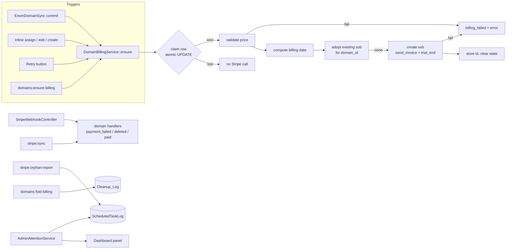
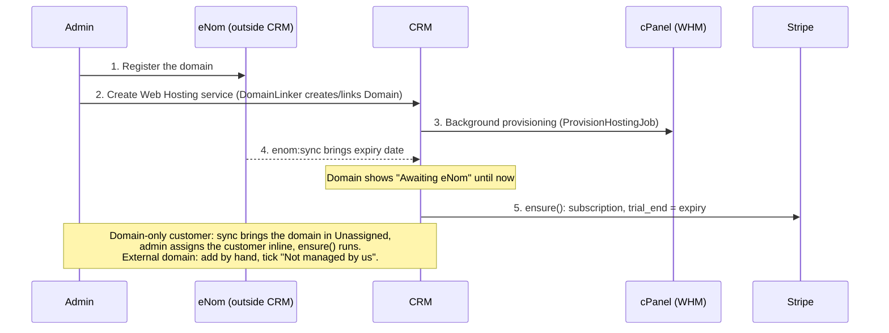
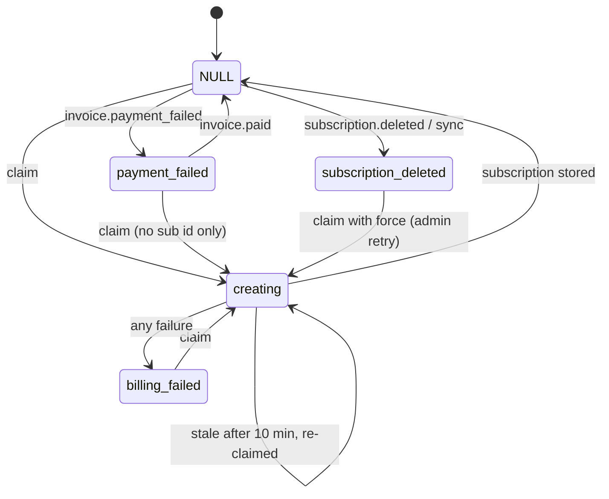

# Design Document

## Overview

This design makes the Domain the owner of its yearly renewal subscription, creates that subscription automatically, folds the duplicate "Domain Name - Annual Registration Fee" services into their domains, and adds a "Needs attention" panel to the admin dashboard. It builds on the previous spec (`services-domains-data-cleanup`) and reuses its pieces: `DomainNormaliser`, `DomainEditTracker`, `Domain::ENOM_FIELDS`, the Domain scopes, `ServiceBillingService` (the `billing_state` / `billing_error` pattern), `ProvisioningDispatcher` (atomic claim), `ServiceDataCleanupChange` (reversible change log), `ScheduledTaskLog`, `x-status-badge`, `customer-picker`, and the test helpers `Tests\Support\Gen` and `FakeStripeService`.

Facts from the repository that shape the design (read, not assumed):

- `domains.stripe_subscription_id` exists and is **not unique**. `services.stripe_subscription_id` **is unique**. Any move of a subscription id from a service to a domain must clear the service first.
- `StripeService::createInvoicedSubscription($customerId, $priceId, $metadata)` already sets `collection_method = send_invoice` and `days_until_due = 7`. It gains an optional `$options` array (for `trial_end`, `proration_behavior`, idempotency key). `ensureCustomerWithEmail` is reused as is.
- The webhook controller already wraps the `processed_webhook_events` marker and the handlers in one transaction and runs side effects from an `$afterCommit` list. It looks up `Service` only. `invoice.paid` is handled only for `subscription_create` on shop orders.
- `StripeSyncInvoices` already updates domain `cost` for matching subscriptions. It does not clear cancelled ones.
- `EnomDomainSync::apply()` runs in one transaction and `EnomSyncDomains` is a thin wrapper that logs to `ScheduledTaskLog`. `Domain` uses `SoftDeletes`.
- `FulfilmentService::holdOrderForDomainConflict()` appends a line starting `Held: domain` to `orders.admin_notes`. `OrderCancellationService::compensateStripe()` appends compensation failures to `admin_notes`.
- The foreign keys that point at `services.service_id` today are `order_items.service_id` (null on delete), `tickets.service_id` (null on delete) and `customer_apps.service_id` (cascade). The fold command still discovers them from the schema at run time, so a later table is covered.
- `hosting:fail-stale`, `enom:sync` and `stripe:sync` already write `ScheduledTaskLog` rows. The five-minute `heartbeat` does too.
- `routes/console.php` runs every command through `Schedule::call(fn () => Artisan::call(...))` because `proc_open` is disabled. New schedule entries follow that.
- `Setting::get()` caches forever per key and `Setting::set()` forgets the key. Settings are plain key/value rows.
- Stripe limits a trial to 730 days (2 years) ([Stripe free trials](https://docs.stripe.com/billing/subscriptions/trials/free-trials)). The design uses 725 days as the usable window to leave a safety margin for clock skew. Content was rephrased for compliance with licensing restrictions.

## Architecture



### Operating workflow



## Components and Interfaces

### Schema (new migrations, additive, guarded with `hasColumn`)

| # | Migration | Content |
|---|---|---|
| D1 | `add_billing_columns_to_domains_table` | `managed_externally` boolean not null default false, `billing_state` string(20) null, `billing_error` text null, `billing_updated_at` timestamp null. Index on `billing_state`. |
| D2 | `seed_domain_billing_settings` | `insertOrIgnore` into `settings`: `domain_stripe_price_id = price_1QXM7mKOtRMQ2ybuHlnPu2hx`, `domain_billing_exempt_company_id = 1`. Never overwrites an existing row. `down()` leaves settings alone. |
| D3 | `add_attention_columns_to_orders_table` | `needs_attention` boolean not null default false (indexed), `attention_reason` string(255) null. Backfill: set `needs_attention = true` and a reason for orders whose `admin_notes` contain a line starting `Held: domain` and whose `fulfilment_status` is not `completed`. |

The fold command needs no migration. It reuses `service_data_cleanup_changes` with the tag `domain-billing-fold`.

`down()` drops what `up()` added. Greenmount (domain 9) is **not** set in a migration, because data fix-ups belong to the reviewed, dry-run-first fold command.

### Domain model additions

```php
public const BILLING_CREATING = 'creating';
public const BILLING_FAILED = 'billing_failed';
public const BILLING_PAYMENT_FAILED = 'payment_failed';
public const BILLING_SUBSCRIPTION_DELETED = 'subscription_deleted';

// Fillable: managed_externally, billing_state, billing_error, billing_updated_at. Cast managed_externally boolean.

scopeBillable(Builder $q)       // company_id not null AND company_id != exemptId AND managed_externally = 0
                                // AND expiry_date NOT NULL AND (stripe_subscription_id IS NULL OR = '')
                                // (soft deletes already excluded by the default global scope)
scopeAwaitingEnom(Builder $q)   // company_id not null AND != exemptId AND managed_externally = 0 AND expiry_date IS NULL
scopeExternallyManaged(Builder $q)
scopeBillingProblem(Builder $q) // billing_state IN (billing_failed, payment_failed)
scopeExpiringWithoutAutoRenew(Builder $q) // expiring() AND auto_renew = 0
public function billingStatus(): string // one label used by the badge: billed, no_subscription, awaiting_enom,
                                        // exempt, not_managed, billing_failed, payment_failed, subscription_deleted
```

`exemptId` comes from `DomainBilling::exemptCompanyId()` (below). When the exempt setting is empty or non-numeric the scopes use `-1`, so nothing is exempt by accident and nothing breaks.

`billingStatus()` precedence: `managed_externally` first (Not managed), then exempt company, then `payment_failed` / `billing_failed` / `subscription_deleted`, then has subscription (Billed), then no expiry (Awaiting eNom), then No subscription.

### DomainBilling settings accessor

`App\Support\DomainBilling` is a small static helper over `Setting`: `priceId()`, `exemptCompanyId(): ?int`, `isExempt(?int $companyId): bool`, `dashboardUrl(string $subId): string` (`https://dashboard.stripe.com/subscriptions/{id}`, with `/test/` when the Stripe key is a test key). It is the only place that knows the setting keys and defaults.

### Billing date (pure)

```php
final class DomainBillingDate {
    public const MAX_DAYS = 725;
    /** @throws ExpiryNotInFutureException when expiry <= today */
    public static function trialEnd(CarbonInterface $expiry, CarbonInterface $today): CarbonImmutable; // 00:00 UTC
    public static function anchoredToAnniversary(CarbonInterface $expiry, CarbonInterface $today): bool;
}
```

Algorithm, with `today` taken as the UTC date:

1. `expiry <= today` throws `ExpiryNotInFutureException`.
2. `expiry <= today + 725 days` returns expiry at 00:00 UTC (Requirement 4.1).
3. Otherwise subtract whole years from expiry (using `subYearsNoOverflow`, so 29 February becomes 28 February) until the result is at most `today + 725 days`, and return that date at 00:00 UTC. The result is always later than today because each step removes one year from a date more than 725 days ahead, which leaves it more than 360 days ahead.

**Decision and justification for expiry far in the future.** The domain price is a yearly fee. ENom allows registrations of up to 10 years, so an expiry over 725 days out cannot be used as `trial_end`. Two fallbacks were considered: fail and ask the admin, or anchor to the latest in-window anniversary. Failing would put every multi-year domain on the "billing failed" list for a normal situation, which trains admins to ignore the list. Anchoring to the anniversary keeps one rule ("billed once a year on the expiry anniversary") and needs no admin step. The cost is that the customer is invoiced yearly for a domain whose registration is already paid for multiple years. That matches the product ("Annual Registration Fee"). The subscription metadata records `anchor` as `expiry` or `anniversary`, so reports can tell them apart. An expiry in the past or today fails with a message, because charging immediately or silently skipping a lapsed domain is an admin decision. The Admin fixes it by correcting the expiry after renewal, or ticks "Not managed by us".

### DomainBillingService

```php
final class DomainBillingService {
    public function __construct(StripeService $stripe);

    /** @return DomainBillingResult  outcome: billed | already_billed | skipped | awaiting_enom | failed, + subscription id/message */
    public function ensure(Domain $domain, bool $force = false): DomainBillingResult;

    /** Defers ensure() until after the current transaction commits (runs now when none is open). */
    public function ensureAfterCommit(Domain $domain): void;
}
```

`ensure()` steps:

1. Re-read the row. If `stripe_subscription_id` is set, return `already_billed` (no Stripe write; Req 5.1). If it is not billable (`Domain::billable()` does not match by id), return `skipped`. If `expiry_date` is null and the customer is non-exempt and managed, return `awaiting_enom` (not an error; Req 7.6, 14.3).
2. If `billing_state = subscription_deleted` and `!$force`, return `skipped` (Req 6.8).
3. **Claim.** One atomic statement:

   ```sql
   UPDATE domains SET billing_state='creating', billing_updated_at=NOW(), billing_error=NULL
   WHERE id=? AND (stripe_subscription_id IS NULL OR stripe_subscription_id='')
     AND ( billing_state IS NULL
        OR billing_state IN ('billing_failed','payment_failed')
        OR (billing_state='subscription_deleted' AND :force)
        OR (billing_state='creating' AND billing_updated_at < NOW() - INTERVAL 10 MINUTE) )
   ```

   Zero rows means another worker holds it: return `skipped` and make no Stripe call (Req 5.2, 5.3). The same pattern is used by `ProvisioningDispatcher`. The 10 minute stale rule recovers a crashed run; the adopt step and the idempotency key keep that recovery safe.
4. Resolve the Stripe customer with `ensureCustomerWithEmail($customer, null)`.
5. Validate the price with `StripeService::retrievePrice(DomainBilling::priceId())` against `DomainPriceValidator` (active, recurring, `interval = year`, `interval_count = 1`). Failure sets `billing_failed` with `"Price {id}: {rule}"` (Req 2.9).
6. Compute `trialEnd` via `DomainBillingDate`. `ExpiryNotInFutureException` sets `billing_failed` with the admin message (Req 4.3).
7. **Adopt.** `StripeService::findSubscriptionForDomain($stripeCustomerId, $priceId, $domainId)` lists the customer's non-cancelled subscriptions on that price and returns one whose `metadata.domain_id` equals the domain id. If found, store it and finish (Req 5.5).
8. **Create.** `createInvoicedSubscription($customerId, $priceId, $metadata, $options)` with `metadata = {company_id, domain_id, domain_name, anchor}`, `options = {trial_end, proration_behavior: 'none', idempotency_key: "domain-sub-{id}-{trial_end}"}`. No invoice item is added, so nothing is charged before `trial_end` (Req 4.5).
9. **Store.** `UPDATE domains SET stripe_subscription_id=?, billing_state=NULL, billing_error=NULL` guarded by `WHERE stripe_subscription_id IS NULL OR = ''`. If the guarded update changes no row (a rare external write), log it and report `failed` with "subscription created but not stored: {id}" so the orphan report and an admin can reconcile.
10. On any `Throwable` from steps 4 to 8: set `billing_state='billing_failed'`, `billing_error` truncated to 1000 characters, log, and return `failed`. Never rethrow (Req 6.6).

`ensureAfterCommit()` uses `DB::afterCommit()`, so a call made inside a request transaction runs after commit (Req 3.7). The Stripe calls never sit inside a transaction (Req 3.6). The test double records `DB::transactionLevel()` per call, as in the previous spec.

**Why no row lock around the Stripe call.** A held lock would block the web request on a network call. The conditional `UPDATE` is the lock, it is atomic on MySQL and SQLite, and the claim state is visible to admins.

### StripeService additions (read helpers and optional options)

```php
public function retrievePrice(string $priceId): \Stripe\Price;                 // expands product
public function retrieveSubscription(string $subscriptionId): Subscription;    // read only
public function findSubscriptionForDomain(string $customerId, string $priceId, int $domainId): ?Subscription;
public function listActiveSubscriptions(?string $priceId = null): iterable;    // auto-paginating, status 'active'|'trialing'|'past_due'
public function createInvoicedSubscription(string $customerId, string $priceId, array $metadata = [], array $options = []): Subscription;
```

`FakeStripeService` gains the same methods, records them under distinct kinds (`read` and `write`), and exposes `writeCalls()` so tests can assert that the fold and orphan commands made no write.

### Triggers

- **eNom sync.** `EnomDomainSync::apply()` collects the ids of domains whose `expiry_date` changed from null to a value, including newly created domains that arrive with an expiry. It returns them in `result['billing_candidates']`. `sync()` stays side-effect free apart from the database; `EnomSyncDomains` calls `DomainBillingService::ensure()` for each candidate after `sync()` returns (the transaction has committed), each in its own try/catch so one failure cannot affect the rest. Candidates are only domains for which `Domain::billable()` matches.
- **Inline assign** (`DomainController::assign`): after saving `company_id`, call `ensureAfterCommit()` when the new customer is not exempt. If the domain already had a `stripe_subscription_id` and the customer changed, flash a warning instead (Req 6.7).
- **Create / update** (`DomainController::store`, `update`): after `Domain::create` / `update`, call `ensureAfterCommit()`. Saving `managed_externally` goes through the same `DomainRequest`.
- **Retry** (`POST admin/domains/{domain}/retry-billing`, route `admin.domains.retry-billing`): calls `ensure($domain, force: true)` and flashes the outcome. Allowed in states `billing_failed`, `payment_failed`, `subscription_deleted`, or when the domain is billable with no state; otherwise it flashes an error. For `payment_failed` the domain still has a subscription id, so retry only reports that it is already billed and clears nothing. The Admin resolves payment failures in Stripe, and `invoice.paid` clears the state.
- **Daily command.** See below.

### Ensure command

`php artisan domains:ensure-billing {--apply}`:

- Selects `Domain::billable()->orderBy('expiry_date')` plus `Domain::awaitingEnom()` for the report.
- Dry run (default): prints `domain, customer, expiry, billing date, anchor` per Billable_Domain, plus a line per awaiting domain, and a summary. Reads Stripe not at all (it does not validate the price), so a dry run is safe and fast. It writes only the `ScheduledTaskLog` row.
- `--apply`: calls `ensure()` per domain (skipping `subscription_deleted` as designed), prints the outcome, and logs `{billed, already, skipped, awaiting, failed}` in the log meta. The task fails (`ScheduledTaskLog::fail`) only on an unexpected exception, not when individual domains fail billing; those are visible as `billing_failed` on the dashboard.
- Added to `SettingsController::runnableCommands` and the `in:` validation, always run without `--apply` from the UI.
- Scheduled in `routes/console.php`: `Schedule::call(fn () => Artisan::call('domains:ensure-billing', ['--apply' => true]))->dailyAt('03:30')->name('domains-ensure-billing')`. It runs after `enom:sync` (03:00).

### Webhook handling

`StripeWebhookController` gains domain branches inside the existing transaction. Handlers pass an `$afterCommit` list, as today.

```php
// invoice.payment_failed
$service = Service::where('stripe_subscription_id', $subId)->first();
if ($service)  { /* existing behaviour, unchanged */ return; }
$domain = Domain::where('stripe_subscription_id', $subId)->first();   // trashed rows included: withTrashed()
if ($domain) {
    $domain->forceFill(['billing_state' => 'payment_failed', 'billing_error' => $reason])->save();
    $afterCommit[] = fn () => $this->notificationService->notifyAdminDomainPaymentFailed($domain, $reason);
}
// customer.subscription.deleted
$domain->forceFill(['stripe_subscription_id' => null, 'billing_state' => 'subscription_deleted',
                    'billing_error' => 'Stripe subscription '.$subId.' was deleted on '.now()->toDateString()])->save();
// invoice.paid (any billing_reason)
if domain matches && billing_state == 'payment_failed' => clear state and error.
```

Notes:

- Services take precedence, so a subscription id on both a service and a domain (legacy duplicates before the fold) keeps the service behaviour (Req 8.9).
- `subscription_deleted` clears `stripe_subscription_id` so the domain lists under "No subscription", and the state stops the daily run from re-subscribing a customer who cancelled on purpose (Req 6.8). Only an Admin retry recreates it.
- The existing `invoice.paid` handler returns early when `billing_reason` is not `subscription_create`; the domain branch runs **before** that early return, because a renewal payment is what clears `payment_failed`.
- `NotificationService::notifyAdminDomainPaymentFailed()` is new and follows the existing admin notification methods (mail to admins, queued).
- `StripeSyncInvoices::syncSubscriptions()` gets one addition: for a subscription matching a Domain with Stripe status `canceled` or `incomplete_expired`, clear the id and set `subscription_deleted` (Req 8.8). This repairs a missed webhook.

### Admin settings screen

Routes in the admin group: `GET admin/settings/domain-billing` (`settings.domain-billing`), `PUT` the same path (`settings.domain-billing.update`), `POST admin/settings/domain-billing/check-price` (`settings.domain-billing.check-price`). New `Admin\DomainBillingSettingsController`.

- `edit`: shows the two stored settings and no Stripe data (Req 2.5).
- `checkPrice`: fetches `retrievePrice()` for the posted id (default the stored one) and redirects back with product name, formatted amount, currency and interval in the flash. A Stripe error becomes an error flash.
- `update`: validates `price_id` with `regex:/^price_[A-Za-z0-9]+$/` and `exempt_company_id` with `nullable|exists:customers,company_id`. If the price id changed, it runs `DomainPriceValidator` against Stripe and rejects on failure (Req 2.6). A Stripe outage leaves the stored value and shows the error (Req 2.7). `Setting::set` is used.
- A link is added to the existing settings navigation.

### Domain screens

- **Index.** New filters `no_subscription` (`Domain::billable()`), `awaiting_enom` (`Domain::awaitingEnom()`), `not_managed` (`Domain::externallyManaged()`), `billing_problem` (`Domain::billingProblem()`). Each pill count and its row list come from the same scope over the same base set, as in the existing controller. The row shows `<x-status-badge type="domain-billing" :status="$domain->billingStatus()">`. The `domain-billing` map is added to `status-badge.blade.php` with text labels and the existing "Billing status: X" accessible-name pattern. Eager load nothing extra: `billingStatus()` uses only columns on the row plus the cached exempt id.
- **Edit.** A checkbox "Not managed by us" (`managed_externally`), a billing panel with status badge, `billing_error`, and the subscription id as a link to `DomainBilling::dashboardUrl()`. While the state is `billing_failed`, `payment_failed` or `subscription_deleted` a persistent warning (`role="alert"`) shows the error and a `Retry billing` button (form POST to `admin.domains.retry-billing`).
- Turning on "Not managed" leaves `stripe_subscription_id` untouched. The billable scope excludes the domain (Req 9.7).
- `DomainEditTracker` is unaffected: `managed_externally` is not an eNom field.

### Fold command (one-off cleanup)

`php artisan domains:fold-billing {--apply} {--revert}`, backed by `App\Services\DataCleanup\DomainBillingFold` with `plan(): FoldPlan` (read-only) and `apply(FoldPlan): void`. Stripe access is through `StripeService` **read methods only**; the class has no method that can write, and the test double fails the test if a write method is called.

**Plan steps** (value objects, each carrying a human description printed in the dry run):

| Step | Effect |
|---|---|
| `MoveSubscription(from, to)` | Clear `from.stripe_subscription_id` first, then set `to.stripe_subscription_id`. Logged per column. |
| `RetireService(service, domain)` | Delete the service when nothing references it, otherwise set `status = Cancelled` and append the note `Billing moved to domain #N`. |
| `LinkServiceToDomain(service, domain, name)` | Set `services.domain_id` and `services.domain_name`. |
| `SoftDeleteDomain(domain)` | Set `deleted_at`. Only when no service links to it after earlier steps. |
| `SetManagedExternally(domain)` | Set `managed_externally = 1`. |
| `Skip(reason)` | Printed, never applied. |

**Detectors (generalised):**

1. *Duplicate registration services.* For each service with `service_type = Other` and a non-empty `stripe_subscription_id`: read the subscription (read-only). If its price is the Domain_Price and its status is `active`, `trialing` or `past_due`, resolve a domain by `domain_id`, else by `DomainNormaliser::tryNormalise(services.domain_name)` matching `domains.domain_name`. Plan `MoveSubscription(service, domain)` when the domain has no subscription, then `RetireService`. If the domain already has a different subscription, plan `Skip("domain already billed")`. Both Stripe-linked and the retired service ids are reported.
2. *Domain holding a non-domain subscription.* For each domain with a subscription: read it. If the price is not the Domain_Price, read `metadata.service_id`; if it names an existing service whose `stripe_subscription_id` is empty, plan `MoveSubscription(domain, service)`. Otherwise `Skip`.
3. *Reference discovery.* `RetireService` asks `ServiceReferences::for($serviceId)`, which uses `Schema::getForeignKeys()` for each table (`Schema::getTables()`), selects keys that reference `services.service_id`, and counts matching rows. Any count above zero means "referenced" (Req 10.6 to 10.8). The same helper is reused by the test for the "no hidden FK" property.

**Explicit fix-ups.** A constant list in `DomainBillingFold::FIXUPS`, reviewed before production and each guarded by pre-conditions that are re-checked at plan time. A fix-up whose pre-conditions fail becomes `Skip` with the failed condition.

| Fix-up | Pre-conditions | Steps |
|---|---|---|
| Giant's Seat | domain 36 `giantseat.org.uk` holds `sub_1UZzJqKOtRMQ2ybupKDl6BAs`, service 142 exists with empty `stripe_subscription_id` and `domain_id = 36`, domain 35 `giantsseat.org.uk` has an empty subscription id and no linked service, Stripe shows `sub_1UZzIGKOtRMQ2ybuTljfxRoL` active on the Domain_Price | Move 36 sub to service 142. Set domain 35 sub to `sub_1UZzIG…`. Link service 142 to domain 35 with `domain_name = giantsseat.org.uk`. Soft delete domain 36. |
| Greenmount | domain 9 `greenmount.org.uk`, registrar FREEOLA, no expiry | `managed_externally = 1`. |
| Services 139 and 140 | Covered by detector 1; no explicit entry needed. The dry run on production confirms them. |

**Apply.** Steps are grouped (one group per service or domain pair) and each group runs in one `DB::transaction`. A failed group rolls back and is reported; independent groups continue (Req 10.16, 10.17). Every changed column is written to `ServiceDataCleanupChange::record('domain-billing-fold', ...)`. A deleted service is logged as `column_name = '__row__'`, `old_value = json(row)`, `new_value = null`, and a soft-deleted domain as `deleted_at` old/new. Idempotence follows from planning against current data: after apply, detectors find nothing and the fix-ups' pre-conditions no longer hold, so the second plan is empty (Req 10.15).

**Revert.** `--revert` replays the log rows with the tag in reverse `id` order, restoring column values and re-inserting `__row__` snapshots (with their original primary keys), inside one transaction, then deletes those log rows. It never touches Stripe. Reverting a subscription move restores the service's id only after clearing the domain's, in reverse order, so the unique index holds.

**Safety notes.** Subscription metadata in Stripe keeps its old `service_id` after the fold. That is harmless because all lookups use the subscription id. The command is added to the Scheduled Tasks whitelist as a dry run only (Req 10.18). The runbook in Tasks requires a production dry run and review before `--apply`.

### Orphan report

`php artisan stripe:orphan-report {--all}`: iterates `listActiveSubscriptions($all ? null : DomainBilling::priceId())`, collects ids from `domains.stripe_subscription_id` and `services.stripe_subscription_id` (including trashed domains) into one in-memory set (small tables), and lists subscriptions not in the set. It records `{orphans: [...up to 200], total, scope}` in `ScheduledTaskLog` meta with status `completed`, or `fail()` on error (Req 11.4, 11.8). Each entry holds `subscription_id`, `customer`, `price_id`, `created`. It is scheduled weekly (`weeklyOn(0, '05:00')`) and whitelisted (it is read-only, so it may run live from the UI). A page `GET admin/stripe/orphans` (`admin.stripe.orphans`) shows the latest completed run's list with links to the Stripe dashboard.

### Orders attention flag

- `Order` gains `scopeNeedsAttention()`, fillable `needs_attention`, `attention_reason`, and a cast.
- `FulfilmentService::holdOrderForDomainConflict()` sets the flag and reason in the same update that writes the note. The note line stays for history and so the existing repeat-delivery check keeps working.
- `OrderCancellationService::compensateStripe()` sets the flag and reason (`Stripe compensation failed: ...`) alongside the note.
- `Admin\ShopOrderController` clears the flag on `fulfil`, `cancel`, and a new `POST shop/orders/{order}/resolve-attention` (`admin.shop.orders.resolve-attention`). The order list adds a `needs_attention` filter using `Order::needsAttention()`.

### Attention service and dashboard panel

```php
final class AdminAttentionService {
    /** @return list<AttentionItem> only items with count > 0, in a fixed order */
    public function items(): array;
}
final class AttentionItem { key, label, count, url, accessibleName }
```

`DashboardController@index` calls `items()` and passes `$attentionItems`. The Blade partial `admin/partials/attention-panel.blade.php` renders nothing when the list is empty, otherwise a `<section aria-labelledby="attention-heading">` with an `<h2>` and a `<ul>`; each `<li>` holds a link whose text is `"{label}: {count}"` and `aria-label` is the accessible name. Colour is decorative only. The route is already inside the admin group, so only Admins see it (Req 13.9). Nothing is cached (Req 13.6).

**Queries (fixed count).** Each item runs one `count()` through the shared model scope, so the list screens and the panel cannot drift apart. That is one query per item (about 14 in total), a constant that does not depend on row count (Requirement 13.5). No eager loading is needed because the panel shows counts only. The orphan item and the task items read `ScheduledTaskLog` with a fixed number of queries (see below).

| Item key | Count source | Link |
|---|---|---|
| `hosting_failed` | `Service::webHosting()->provisioningFailed()` | `admin.hosting.provision.index?status=failed` |
| `hosting_stuck` | `Service::provisioningStuck(15)` (`running` and `provisioning_updated_at` older than 15 minutes) | `…?status=stuck` (new filter value using the same scope) |
| `service_billing_failed` | `Service::billingFailed()` | `admin.services.index?billing=failed` (new filter) |
| `domains_no_subscription` | `Domain::billable()` | `admin.domains.index?filter=no_subscription` |
| `domains_awaiting_enom` | `Domain::awaitingEnom()` | `?filter=awaiting_enom` |
| `domains_billing_problem` | `Domain::billingProblem()` | `?filter=billing_problem` |
| `domains_missing_enom` | `Domain::missingFromEnom()` | `?filter=missing` |
| `domains_unassigned` | `Domain::visible()->unassigned()` | `?filter=unassigned` |
| `domains_expiring_no_renew` | `Domain::expiringWithoutAutoRenew()` | `?filter=expiring_no_renew` (new) |
| `orders_attention` | `Order::needsAttention()` | `admin.shop.orders.index?needs_attention=1` |
| `orphans` | `meta.total` of the latest completed `stripe:orphan-report` | `admin.stripe.orphans` |
| `tasks` | number of tasks failing or overdue (below) | `admin.settings.tasks` |

The scopes `Service::provisioningFailed()`, `provisioningStuck()`, `billingFailed()`, `webHosting()` are new on `Service`; the existing screens switch to them so lists and counts share one definition (Req 13.4). The existing "missing from eNom" and "unassigned" counts already come from Domain scopes.

**Task health.** `ScheduledTaskHealth::problems(): list<array{task, reason}>` runs one query returning the latest row per tracked task (`max(id)` grouped by `task_name`, then `whereIn id`) and one for the latest *completed* row per task. Allowances: `enom:sync`, `stripe:sync`, `domains:ensure-billing` 36 hours; `hosting:fail-stale` 30 minutes; `heartbeat` 15 minutes. A task is **failed** when its latest row has status `failed`. It is **overdue** when it has no completed row within its allowance and is not currently `running` for under 30 minutes. A task with no row at all is overdue only if the application has been deployed longer than the allowance; to keep it simple and avoid false alarms on a fresh install, a task with no rows is reported as `no runs recorded` only for `heartbeat`. The panel item lists the first three task names in the accessible name's description line and links to the Scheduled Tasks page.

### Documentation

`DEPLOYMENT.md` gains a short "Domain billing" section: the workflow diagram above, the production rollout steps from the Tasks notes, and the rule that no subscription is created until `domains:ensure-billing --apply` runs. `DEPLOYMENT.md` is the only existing operational document.

## Data Models

| Table | Column | Type | Migration |
|---|---|---|---|
| domains | `managed_externally` | boolean, not null, default 0 | D1 |
| domains | `billing_state` | string(20) null, indexed | D1 |
| domains | `billing_error` | text null | D1 |
| domains | `billing_updated_at` | timestamp null | D1 |
| orders | `needs_attention` | boolean, not null, default 0, indexed | D3 |
| orders | `attention_reason` | string(255) null | D3 |
| settings | `domain_stripe_price_id`, `domain_billing_exempt_company_id` | rows | D2 |

Billing state transitions on a Domain:



## Correctness Properties

*A property is a characteristic or behavior that should hold true across all valid executions of a system-essentially, a formal statement about what the system should do. Properties serve as the bridge between human-readable specifications and machine-verifiable correctness guarantees.*

Reflection on the prework: the billable definition (1.1, 9.7) and the "non-billable creates nothing" rule (1.5) overlap, so Property 1 covers the set and Property 2 covers the no-Stripe consequence. The three ensure-command criteria (7.1 to 7.3) reduce to one dry-run/apply property. Webhook criteria 8.1 to 8.4 become one transition property and 8.5 to 8.7 one exactly-once property. Counts for filters, orders and the dashboard (9.1, 9.2, 12.5, 13.2 to 13.4) share one equality property. Criteria classified as example, smoke or not testable (settings storage, schedule entries, whitelist, badge text, page rendering) are covered by unit and feature tests.

### Property 1: Billable set equals the definition

For any set of generated domains with any combination of customer (none, exempt, other), `managed_externally`, trashed state, expiry (null or a date) and subscription id (null, empty, set), `Domain::billable()` returns exactly the domains with a non-exempt customer, not externally managed, not trashed, with an expiry and no subscription id, and `Domain::awaitingEnom()` returns exactly the non-exempt, managed, non-trashed domains with a customer and no expiry.

**Validates: Requirements 1.1, 1.2, 1.3, 9.7**

### Property 2: Non-billable domains create no Stripe object

For any domain outside `Domain::billable()`, calling `ensure()` (with or without force) makes no Stripe write call and leaves `stripe_subscription_id` unchanged.

**Validates: Requirements 1.5, 7.6, 14.3**

### Property 3: Price validation

For any Stripe price object, the validator accepts it if and only if it is active, recurring, has interval `year` and interval count 1; for any rejected price, `ensure()` on a billable domain creates no subscription and sets `billing_failed` with an error naming the price id.

**Validates: Requirements 2.6, 2.8, 2.9**

### Property 4: Billing date

For any expiry date and today's date with `expiry > today`, `trialEnd` is at 00:00 UTC, is later than today, is at most 725 days after today, equals the expiry when the expiry is within 725 days, and otherwise equals the expiry minus a whole number of years; for any expiry at or before today it throws `ExpiryNotInFutureException`.

**Validates: Requirements 4.1, 4.2, 4.3, 4.4**

### Property 5: Created subscription parameters

For any billable domain, a successful `ensure()` sends exactly one create call with the Domain_Price, `send_invoice`, `days_until_due` 7, proration `none`, `trial_end` equal to the billing date, metadata `company_id`, `domain_id` and `domain_name` equal to the domain's values, no invoice item, and it stores the returned id in `stripe_subscription_id` with `billing_state` and `billing_error` cleared.

**Validates: Requirements 3.1, 3.2, 3.3, 3.4, 4.5**

### Property 6: Failure is recorded and recoverable

For any billable domain and any single Stripe failure at the customer, price, adopt or create step, `ensure()` ends with `billing_state = billing_failed`, a non-empty `billing_error`, an unchanged `stripe_subscription_id`, and a later `ensure()` with force after the fault clears results in a stored subscription id and an empty state.

**Validates: Requirements 3.5, 6.6**

### Property 7: Idempotence and at most one subscription

For any billable domain and any sequence of `ensure()` calls (including repeated calls, calls after a stale `creating` claim, and calls interleaved with an already-existing Stripe subscription whose `domain_id` metadata matches), at most one Stripe create call is made, at most one subscription id is stored, calls on a domain that already has an id make no Stripe write call, and an existing matching subscription is adopted instead of creating another.

**Validates: Requirements 5.1, 5.2, 5.3, 5.4, 5.5, 5.7**

### Property 8: Deleted subscriptions are not recreated automatically

For any domain with `billing_state = subscription_deleted`, `ensure()` without force, the ensure command with `--apply`, and every automatic trigger make no Stripe call and leave the row unchanged, while `ensure()` with force creates exactly one subscription.

**Validates: Requirements 6.8**

### Property 9: Ensure command dry run and apply

For any set of domains, `domains:ensure-billing` without `--apply` changes no row in `domains` and makes no Stripe write call and lists exactly the Billable_Domains, and with `--apply` it attempts exactly the Billable_Domains that are not `subscription_deleted`, with counts in the task log equal to the outcomes.

**Validates: Requirements 7.1, 7.2, 7.3**

### Property 10: Domain webhook state transitions

For any domain with a subscription id and no service with that id, a payment-failed event sets `billing_state = payment_failed` and stores the reason, a subscription-deleted event clears the id and sets `subscription_deleted`, an invoice-paid event on a `payment_failed` domain clears the state, and a payment-failed event for an id that matches a service leaves every domain unchanged.

**Validates: Requirements 8.1, 8.3, 8.4, 8.9**

### Property 11: Domain webhook exactly-once and atomic

For any domain Stripe event delivered one or more times, the domain change and the admin notification happen at most once; every redelivery returns HTTP 200 without a further change; and for any injected handler failure the marker and the domain change are rolled back, the response is non-2xx, no notification is sent, and a later redelivery processes the event normally.

**Validates: Requirements 8.2, 8.5, 8.6, 8.7**

### Property 12: Fold dry run writes nothing and never writes to Stripe

For any generated dataset of services, domains and fake Stripe subscriptions, `domains:fold-billing` without `--apply` leaves every table row unchanged, writes no Cleanup_Log row, and makes only Stripe read calls; the same holds for `--apply` (no Stripe write call).

**Validates: Requirements 10.1, 10.2, 10.3**

### Property 13: Fold planning rules

For any dataset, the plan moves a service's subscription to a domain if and only if the service is of type `Other`, its subscription is active on the Domain_Price, it resolves to a domain by `domain_id` or by normalised name, and that domain has no subscription; each retired service is deleted exactly when no table with a foreign key to `services.service_id` has a row for it, and otherwise cancelled with the note "Billing moved to domain #N"; and a domain holding a non-domain-price subscription is moved to the service named in `metadata.service_id` only when that service exists with an empty subscription id.

**Validates: Requirements 10.4, 10.5, 10.6, 10.7, 10.8, 10.9, 10.16**

### Property 14: Fold apply is idempotent and reversible

For any dataset, after `--apply` no two rows (domain or service) hold the same subscription id, a second `--apply` plans and writes nothing, and `--revert` restores every service, domain and subscription column to the values it had before the first `--apply`, including deleted service rows with their original primary keys.

**Validates: Requirements 10.13, 10.14, 10.15, 10.17**

### Property 15: Orphan listing

For any set of Stripe subscriptions and CRM rows, the orphan report lists exactly the active subscriptions on the Domain_Price (or on any price with `--all`) whose id appears in no domain (including trashed) and no service, and records a list of at most 200 entries with the true total.

**Validates: Requirements 11.1, 11.2, 11.4**

### Property 16: Attention counts equal filtered list counts

For any generated data, every attention item's count equals the number of rows returned by the screen its link points to (same filter, unpaginated), and an item is present if and only if its count is above zero.

**Validates: Requirements 9.1, 9.2, 12.5, 13.1, 13.2, 13.3, 13.4**

### Property 17: Constant query count

For any number of generated domains, services, orders and task logs, `AdminAttentionService::items()` runs the same number of database queries.

**Validates: Requirements 13.5**

### Property 18: Scheduled task health

For any set of task log rows, a tracked task is reported failed if and only if its latest row has status `failed`, and overdue if and only if it has no completed row newer than its allowance (36 hours, 30 minutes or 15 minutes) and is not within a running window; and the number of tasks reported equals the number of tasks that are failed or overdue.

**Validates: Requirements 13.7, 13.8**

## Error Handling

| Situation | Behaviour |
|---|---|
| Price missing, inactive or not yearly | `billing_failed` with the price id and failed rule. No subscription. |
| Expiry today or in the past | `billing_failed` with an admin message. No subscription. |
| Stripe error at customer, adopt or create | `billing_failed` with the message (truncated). The triggering action still succeeds. |
| Another worker holds the claim | No Stripe call. Result `skipped`. |
| Crash during `creating` | After 10 minutes the claim can be retaken. Adopt step and idempotency key prevent a duplicate. |
| Subscription created but id not stored | Result `failed` with the subscription id in the error. The weekly orphan report also lists it. |
| Customer reassigned while a subscription exists | Warning flash. Subscription left alone. |
| Customer cancels subscription in Stripe | `subscription_deleted`, no automatic recreate. Admin retry recreates. |
| Webhook handler throws | Transaction and marker rolled back, HTTP 500, Stripe retries. |
| Fold: Stripe read fails or price unexpected | Step skipped and reported, independent groups continue. |
| Fold: group fails | That group rolls back. Others continue. Exit code is failure so the Task_Log shows it. |
| Fold: pre-condition of an explicit fix-up no longer holds | `Skip` with the failed condition. |
| Settings: Stripe unreachable on save | Stored value unchanged. Error shown. |
| Orphan report fails | Failed Task_Log entry with the error. Panel shows the failed task. |
| Empty or invalid exempt setting | Treated as no exempt company. No error. |

## Testing Strategy

Property-based testing applies to this feature: the billable definition, billing date, idempotence, webhook transitions, fold planning and the dashboard counts are pure or in-memory logic with large input spaces. The repository has no property-testing library (`composer.json`), so, as in the previous spec, each property is a seeded PHPUnit loop of at least 100 iterations using `Tests\Support\Gen` (extended with generators for domains, services, fake Stripe subscriptions and task logs). The seed is included in every assertion message so failures reproduce. No new dependency is added.

- **Property tests**: one test per property, tagged `Feature: domain-billing-and-admin-attention, Property N: <title>`. Stripe is `FakeStripeService` (extended with price, subscription read helpers, `writeCalls()` and failure injection). Database is SQLite in memory, using `DomainFactory` and `ServiceFactory`. Property 11 reuses the webhook test pattern with `Mail::fake()`.
- **Unit tests**: `DomainBillingDate` examples (29 February, exactly 725 and 726 days, today), `DomainPriceValidator`, `DomainBilling` defaults, status badge labels, `ServiceReferences` against the real FK list.
- **Feature tests**: settings screen (no Stripe call on load, check price, reject invalid price, Stripe outage), each trigger (eNom sync candidates, assign, create, update, retry, reassign warning), domain index filters and badges, edit warning and retry, orders flag set and cleared (domain conflict hold, compensation failure, fulfil, cancel, resolve), dashboard panel (hidden at zero, items, links, admin only, accessible names), whitelist and schedule entries, orphan page.
- **Fold command**: a fixture reproducing the production shapes (services 139/140 with domains 32/34, Giant's Seat 35/36/142, Greenmount 9) asserts the printed plan, the applied result, idempotence and revert. A schema test asserts `ServiceReferences` finds `order_items`, `tickets` and `customer_apps`.
- **Smoke**: a source scan asserts no code calls eNom registration or any Stripe write method inside the fold and orphan classes.
- **MySQL-only behaviour** (the conditional claim with `INTERVAL`) is written with Eloquent date bindings (`billing_updated_at < now()->subMinutes(10)`) so SQLite and MySQL behave the same. The optional `phpunit.mysql.xml` group from the previous spec runs the claim test against MySQL.
- **Baseline**: before the first task, run the full suite and compare any failure with `.kiro/specs/services-domains-data-cleanup/baseline-failures.md`.
