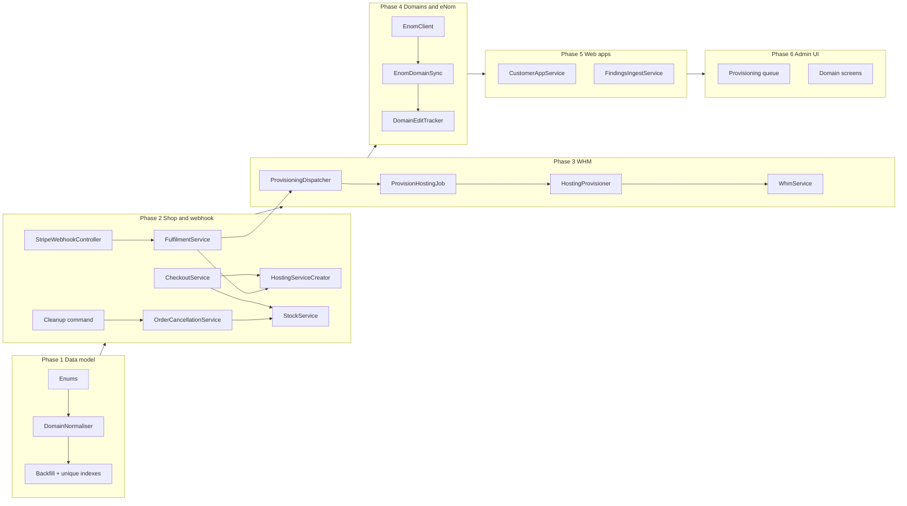
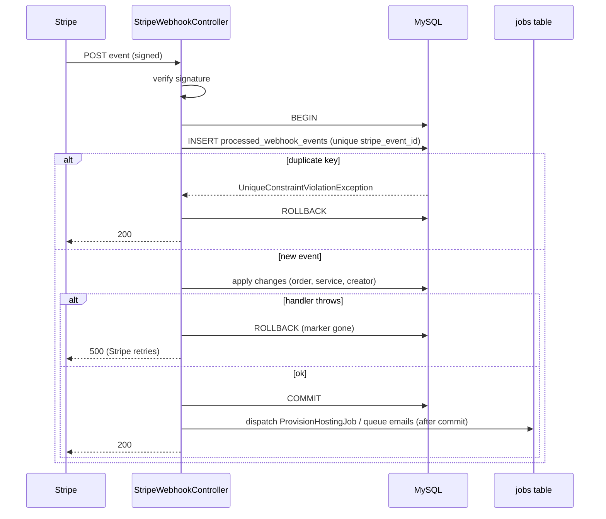
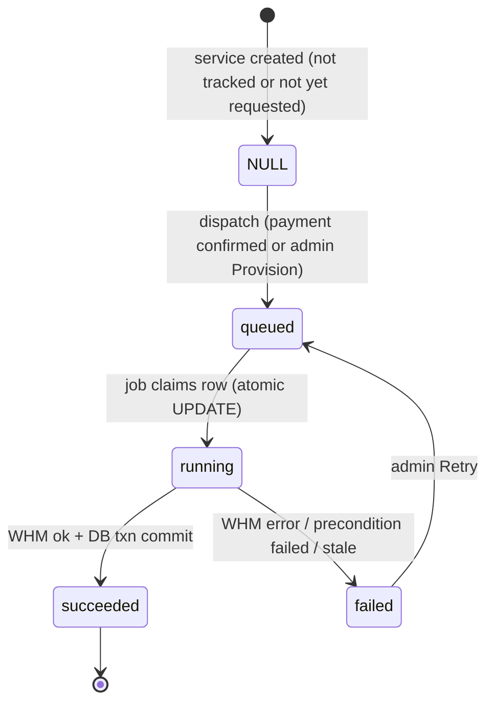

# Design Document

## Overview

This design cleans up the data model and workflows around services, domains, web apps (`CustomerApp`), WHM/cPanel provisioning, eNom sync and shop checkout/fulfilment in the Laravel 13 / PHP 8.3+ CRM. It is delivered in six phases, in the same order as the requirements:

1. Data model (enums, domain normaliser, backfill, unique indexes)
2. Shop and webhook (idempotent service creation, single stock decrement, Stripe ordering, exactly-once webhooks)
3. WHM (one client, TLS always verified, queued idempotent provisioning)
4. Domains and eNom (domain linking, ownership-safe sync, soft deletes)
5. Web apps (creation action, findings ingest, admin service creation/billing)
6. Admin UI (provisioning queue, domain and app screens)

Each phase is independently deployable. Schema changes are additive and nullable first, data is backfilled second, and constraints are added last, so every deploy step can be re-run safely on MySQL (shared cPanel hosting, no SSH, tables are small).

Facts about the environment that shape the design (all read from the repository, not assumed):

- Migrations and one-off commands are run through cPanel cron jobs (`DEPLOYMENT.md`, "Run migrations"). There is no SSH. The admin "Scheduled Tasks" page can run a whitelisted set of artisan commands (`SettingsController::runCommand`, currently `stripe:sync` and `enom:sync`).
- `proc_open` is disabled on the host, so `routes/console.php` runs every scheduled command through `Schedule::call(fn () => Artisan::call(...))`. New scheduled work follows that pattern.
- `config/queue.php` defaults to `QUEUE_CONNECTION=database` and `.env.example` sets `QUEUE_CONNECTION=database`; `jobs` and `failed_jobs` tables exist. `routes/console.php` already schedules `queue:work --stop-when-empty --tries=3` every minute with `withoutOverlapping()`. `DEPLOYMENT.md` also documents an optional separate cron running the same worker, so two workers can overlap. `CACHE_STORE=file`. I did not read `.env`, so the production values must be confirmed during rollout (see Deployment runbook).
- There is no PBT library in `composer.json`. Existing "property" tests are PHPUnit loops over generated data (for example `FulfilmentServiceTest`). This design keeps that convention and adds a small seeded generator helper instead of a new dependency.

## Code Reconciliation

The requirements phase did not read the code. This table lists where the requirements' proposed names or assumptions differ from the repository and what the design does about each. Items marked **Added** go beyond the literal requirements and are needed to make them work.

| Requirement assumption | What the code actually has | Design decision |
|---|---|---|
| `WHM_Client` is a new class | `App\Services\WhmService` already exists (`testConnection`, `createAccount`, settings `whm_hostname`, `whm_api_token`, encrypted with `Crypt`). It hard-codes the WHM user as `root` and skips TLS verification for `localhost`, `192.168.*`, `10.*` (`buildRequest`). | Keep the class name `WhmService` and extend it. Remove the local-host verification bypass. **Added** a `whm_username` setting (default `root`). |
| SsoController location | `app/Http/Controllers/Portal/SsoController.php` (customer portal, ownership check on `company_id`). | Change only the WHM access; keep the ownership guard. |
| Other WHM implementations | `Admin\ServiceController::provisionWhmAccount()` and `fetchWhmAccountInfo()` use `config('services.whm.*')` with `verify => false`. `CpanelMappingController::fetchWhmAccounts()` does the same. `Portal\SsoController::createSession()` uses `config('services.whm.*')` with `verify => true`. | All four call sites move to `WhmService`. |
| `processed_webhook_events.event_id` | Column is `stripe_event_id`, already `unique()` (migration `2026_08_15_100004`). Model is `ProcessedWebhookEvent`. | Requirement 6.1 is already satisfied. A test locks it in; no migration. |
| `customer_apps.service_id` unique index | Already `unique('service_id')` with cascade delete (migration `2026_10_30_100000`). | Requirement 16.2 is already satisfied. Test only. |
| "Public app identifier" for findings ingest | `CustomerApp` has no such column. `FindingsIngestService` resolves by primary key. The MCP tool `record_app_findings` takes integer `app_id`, and the REST route is `POST /mcp/apps/{identifier}/findings`. | **Added** `customer_apps.public_id` (ULID, unique, nullable, backfilled). The ingest, REST route and `record_app_findings` tool use it. `CustomerAppDto` exposes `public_id` so the connector can discover it. |
| `services.status` / `service_type` are enums | Plain `string` columns, no DB enum. Mixed values in code: `'pending'`, `'hosting'`, `'payment_failed'`, `'cancelled'` (checkout, fulfilment, webhook, `ShopOrderController` web and API, `HostingProvisionController`), `'Active'`/`'Cancelled'` (everything else). `CleanupController` also queries `'Domain Registration'`. | PHP backed enums used as the single source of values. Model attributes are **not** cast to enums, so existing `=== 'Active'` comparisons and Blade views keep working. |
| API service validation | `Api\Admin\ServiceController` has `store`/`update` with free-string rules, but `routes/api.php` only exposes `index` and `show` for services. | Shared `ServiceRequest` applies to those methods. No new API routes are added. |
| Stock decremented twice | `CheckoutService::decrementStockForOneOffItems()` decrements by quantity at checkout. `FulfilmentService::handleOneOffPurchase()` decrements by 1 again from the webhook. | Checkout is the only decrement. Fulfilment never touches stock. |
| Duplicate service creation | `CheckoutService::handleHostingItems()` creates a `Service` at checkout, and `FulfilmentService::handleHostingPurchase()` creates a second one from the webhook (mixed carts). | One creator, `HostingServiceCreator`, keyed on `order_item_id`. |
| Stripe calls outside the transaction | `processCheckout()` calls Stripe (session, coupon, subscriptions) inside `DB::transaction`. | Restructure into DB transaction, then Stripe, with compensation. |
| Currency single config value | `StripeService::createOneTimePayment()` reads `config('services.stripe.currency', 'gbp')` but the key is not defined. `CheckoutService` hardcodes `'gbp'` in four places. | Add `services.stripe.currency` (`STRIPE_CURRENCY`, default `gbp`) and use it everywhere. |
| Webhook marker | Controller inserts the marker before the transaction and deletes it in `catch`. Returns 200 when the order is not found, which permanently consumes the event. | Marker inside the transaction. Order-not-found for our own sessions becomes retryable. |
| Hosting payment confirmation | Hosting-only carts have no Checkout Session, so `checkout.session.completed` never fires for them. No `invoice.paid` handler exists. `StripeService::createSubscription` uses `payment_behavior=default_incomplete` and no client secret is returned to the UI. | **Added** an `invoice.paid` handler (first invoice of a hosting subscription) so Requirement 9.1 has a trigger. Collecting payment for hosting-only carts is outside this spec (see Risks). |
| Provisioning package | `products.whm_package` already exists. `HostingProvisionController` ignores it and uses setting `whm_default_package`. Admin create form hard-codes `ckhostco_*` options. | Product package is used. Missing package fails (Req 8.2). **Added** `services.whm_package` so admin-created services can be provisioned and retried. |
| Nameservers single value | Settings `whm_nameserver_0/1` with the default `ns0/ns1.thundercloud.uk` repeated in `WhmConfigController` (twice) and `NotificationService`. | One accessor, `Nameservers::get()`, holds the defaults. |
| `Domain_Sync_Status` etc. | `domains` has no status, soft delete, sync or edit-tracking columns. `domain_name` is already unique. The sync stores the id only inside `enom_response` JSON text. | Columns added in Phase 4. |
| Queue worker | Already scheduled in `routes/console.php`. | Reuse it. Tighten `withoutOverlapping` expiry. |
| Factories | Only `CustomerFactory`, `ProductFactory`, `UserFactory`. `Service`, `Domain`, `Order`, `OrderItem` declare `HasFactory` but have no factory. | **Added** factories (see Testing Strategy). |
| Existing checkout tests | `CheckoutServiceTest` builds `new CheckoutService(stripe, booking, notification)` but the constructor takes four arguments, so those tests very likely fail today. `FulfilmentServiceTest` asserts a stock decrement in `handleEquipmentRentalPurchase`, which the code does not do. | Establish a baseline run first, then migrate (see Testing Strategy). |

## Architecture



### Webhook flow (Phase 2)



### Provisioning flow (Phase 3)



## Components and Interfaces

Namespaces follow the repository (`App\Services`, `App\Http\Requests`, `App\Console\Commands`, `App\Exceptions`). New directories: `app/Enums`, `app/Jobs`, `app/Support` already exists.

### Phase 1: Data model

**Enums** (`app/Enums`, backed string enums, not used as model casts):

```php
enum ServiceType: string {
    case TechnicalSupport = 'Technical Support';
    case WebHosting = 'Web Hosting';
    case Other = 'Other';

    /** @return list<string> */
    public static function values(): array { return array_column(self::cases(), 'value'); }

    /** Case/whitespace-insensitive match plus legacy aliases ('hosting'). Null when no match. */
    public static function fromLoose(?string $raw): ?self { /* trim, mb_strtolower, compare to lower(value) or alias map */ }
}

enum ServiceStatus: string { case Pending = 'Pending'; case Active = 'Active';
                             case Suspended = 'Suspended'; case Cancelled = 'Cancelled';
    public static function fromLoose(?string $raw): ?self { /* aliases: 'pending' */ } }

enum ProvisioningStatus: string { case Queued = 'queued'; case Running = 'running';
                                  case Succeeded = 'succeeded'; case Failed = 'failed'; }

enum DomainSyncStatus: string { case Active = 'active'; case MissingFromEnom = 'missing_from_enom'; }
```

Alias maps are constants on the enum so the data migration, the importer and validation share one definition. Legacy values seen in code and mapped by the backfill: `hosting` to `Web Hosting`, `pending` to `Pending`, `payment_failed` to `Suspended`, `cancelled` to `Cancelled`. Values that match nothing (for example `Domain Registration` if present) are left unchanged and logged (Req 1.11). `CleanupController`'s `'Domain Registration'` query is kept as a legacy detector but no longer offered in any selector.

**DomainNormaliser** (`App\Support\DomainNormaliser`, pure, no framework dependencies):

```php
final class DomainNormaliser {
    /** @throws InvalidDomainException */
    public static function normalise(string $input): string;
    public static function tryNormalise(?string $input): ?string;   // null on null/invalid
    public static function toHttpsUrl(string $canonical): string;   // 'https://' . $canonical
}
```

Algorithm, in order: trim, Unicode lowercase, strip trailing dots (loop), strip leading `www.` (loop, so the function is idempotent for `www.www.x.com`), convert to ASCII with `idn_to_ascii(..., IDNA_NONTRANSITIONAL_TO_ASCII, INTL_IDNA_VARIANT_UTS46)`, then validate: total length at most 253, at least two labels, each label 1 to 63 characters of `[a-z0-9-]` not starting or ending with `-`, final label either alphabetic with at least 2 letters or starting with `xn--`. `intl` is present locally, and `symfony/polyfill-intl-idn` is in `vendor` as a fallback for hosts without it. Anything failing validation throws `InvalidDomainException` (extends `InvalidArgumentException`).

A `ValidDomain` rule and a `NormalisesDomain` request trait (`prepareForValidation()` merges the canonical value) give every entry point the same behaviour: `Admin\DomainController`, `ServiceRequest`, `CartService::add`, `ImportController`, `EnomDomainSync`, `ReviewWizardController`. `CartService::isValidDomain()` becomes a thin wrapper over `tryNormalise() !== null` and keeps its public signature for existing callers.

**ServiceRequest** (`App\Http\Requests\ServiceRequest`, single class, Req 1.3 to 1.5, 18.3). Used by `Admin\ServiceController::store/update` and `Api\Admin\ServiceController::store/update`. Existing request classes are Store/Update pairs, but Req 18.3 asks for one class, so the rules branch on `$this->route('service')` (update uses `sometimes`). Key rules:

```php
'service_type' => [$update ? 'sometimes' : 'required', Rule::enum(ServiceType::class)],
'status'       => ['sometimes', Rule::enum(ServiceStatus::class)],
'domain_name'  => ['nullable', 'required_if:service_type,Web Hosting', new ValidDomain,
                   Rule::unique('services', 'domain_name')->ignore($service?->service_id, 'service_id')],
'cpanel_username' => ['nullable', 'string', 'max:32', 'regex:/^[a-z][a-z0-9]*$/',
                   Rule::unique('services', 'cpanel_username')->ignore($service?->service_id, 'service_id')],
```

Web-only fields (`provision_whm`, `whm_package`, `contact_email`, `stripe_price_id`) are optional in the same class. API-only fields (`stripe_subscription_id`, `next_payment_date`) too. The duplicate check is advisory. The unique index is the guard (Req 12.3, 12.4).

**Data backfill** (`App\Services\DataCleanup\ServiceDomainBackfill`): one class with `plan(): BackfillPlan` (read-only, returns counts and per-row changes) and `apply(BackfillPlan $plan): void`. Used by migration M3, the `services:normalise-data` command, and the tests, so the dry run and the real run cannot drift apart. `plan()` reads only columns that exist before the migrations, so the dry run works against production before any deploy.

**Migrations** (timestamps continue after `2026_10_30_100004`; each is idempotent using `Schema::hasColumn` / `Schema::hasIndex`):

| # | Phase | Migration | Notes |
|---|---|---|---|
| M1 | 1 | `add_integrity_columns_to_services_table` | Nullable `provisioning_status` string(20), `provisioning_error` text, `provisioning_updated_at` timestamp, `domain_id` FK to `domains.id` (nullOnDelete). Nullable adds, no defaults, no table rewrite concerns at this size. |
| M1b | 1 | `add_domain_id_to_order_items_table` | Nullable `domain_id` FK (nullOnDelete). |
| M2 | 1 | `create_service_data_cleanup_changes_table` | Change log: `id`, `migration`, `table_name`, `row_id`, `column_name`, `old_value`, `new_value`, `created_at`. Makes M3 reversible. |
| M3 | 1 | `backfill_service_and_domain_values` | Data only. See below. |
| M4 | 1 | `add_unique_indexes_to_services_table` | Preflight, then `unique(cpanel_username)`, `unique(domain_name)`. |
| M5 | 2 | `add_order_item_link_and_stock_reservation` | `services.order_item_id` (nullable FK to `order_items.id`, nullOnDelete), `order_items.stock_reserved_quantity` unsigned int null. Backfill, then `unique(order_item_id)`. |
| M6 | 3 | `add_whm_package_to_services_table` | Nullable string. |
| M7 | 4 | `add_sync_columns_and_soft_deletes_to_domains_table` | `status` string(32) default `active` indexed, `enom_domain_name_id` string(32) null indexed, `last_synced_at`, `admin_edited_fields` json null, `deleted_at`. M7b (separate migration): backfill `enom_domain_name_id`, then `unique(services.domain_id)`. |
| M8 | 5 | `add_domain_and_public_id_to_customer_apps_table` | `domain_id` FK, `public_id` char(26) null unique, backfilled in chunks. |
| M9 | 5 | `add_fingerprint_to_security_findings_table` | `fingerprint` char(64) null, `last_seen_at`, backfill, de-duplicate, `unique(customer_app_id, fingerprint)`. |
| M10 | 5 | `add_billing_state_to_services_table` | Nullable `billing_state` string(20), `billing_error` text. |

No migration uses `ENUM` or `CHECK` constraints, so there is no `MODIFY COLUMN`. Statuses and types stay `string`, validated in the application. Unique indexes on nullable columns permit multiple NULLs in both MySQL and SQLite. Index key length for `varchar(255)` under utf8mb4 is 1020 bytes, which is within InnoDB limits and already in use (`domains.domain_name`).

**M3 backfill steps**, all inside chunked transactions (200 rows), each change logged to the change-log table:

1. `services.cpanel_username` and `services.domain_name`: trim, convert empty string to NULL (`CpanelMappingController` already writes `''`-tolerant queries, so empty strings may exist and would break a unique index). `cpanel_username` is lower-cased.
2. `services.service_type` / `status`: `fromLoose()` mapping; unmatched values are logged with row id and value and left alone (Req 1.11).
3. Canonicalise `domains.domain_name`, `services.domain_name`, `order_items.domain_name` with `tryNormalise()`. Values that fail normalisation are logged and left unchanged.
4. `provisioning_status = 'succeeded'` for `Web Hosting` services that already have a `cpanel_username`. Other services stay NULL ("not tracked").
5. `services.domain_id` and `order_items.domain_id`: set to the id of the Domain with an equal canonical name when one exists (Req 12.1). No Domain rows are created.

**M4 preflight** (`UniqueIndexPreflight`): queries `GROUP BY ... HAVING COUNT(*) > 1` for each target column, logs every duplicate value with the service ids, and throws before any index is created (Req 2.4). Duplicates among canonicalised `domains.domain_name` values (for example `www.a.com` and `a.com`) are checked the same way in M3 and abort the migration, because merging domains is a human decision.

**Reversibility.** Each migration's `down()` drops what `up()` added (indexes first, then FKs, then columns). M3's `down()` replays the change log in reverse to restore original values, then M2 drops the log. The log is dropped by a later cleanup migration after a soak period, not before.

**Dry-run command** `services:normalise-data {--apply}`: default is read-only. Prints counts per action, unmatched labels, empty-string conversions, would-be duplicates and canonicalisation collisions. Logs through `ScheduledTaskLog` and is added to `SettingsController::runnableCommands` (dry-run only from the UI), so it runs without SSH.

### Phase 2: Shop and webhook

**HostingServiceCreator** (`App\Services\HostingServiceCreator`), the single code path (Req 3.5):

```php
public function forOrderItem(OrderItem $item, Customer $customer): Service
{
    return DB::transaction(function () use ($item, $customer) {
        if ($existing = Service::where('order_item_id', $item->id)->lockForUpdate()->first()) {
            return $existing;
        }
        $canonical = DomainNormaliser::normalise($item->domain_name);
        $domain = $this->domainLinker->findOrCreate($canonical, $customer->company_id);
        try {
            $service = Service::create([ /* company_id, service_short, service_type=Web Hosting,
                status=Pending, domain_name=$canonical, domain_id, order_item_id,
                start_date, charge, frequency, stripe_subscription_id */ ]);
            // whm_package is not written here: that column arrives in Phase 3 (M6), and the
            // provisioner resolves the package from the order item's product.
        } catch (UniqueConstraintViolationException $e) {
            return Service::where('order_item_id', $item->id)->first()
                ?? throw new DomainAlreadyInUseException($canonical, $e);
        }
        $item->update(['service_id' => $service->service_id, 'domain_id' => $domain->id]);
        return $service;
    });
}
```

`order_items.service_id` is kept (read by `ShopOrderController`, `HostingProvisionController`) and written only here. `DomainLinker::findOrCreate()` looks up by canonical name including trashed rows (`withTrashed()` once the Domain model uses `SoftDeletes` in Phase 4; a plain lookup before that), restores nothing, and creates a Domain with `company_id`, `registrar` null, `status = active` when missing (Req 12.2, 3.6). `DomainAlreadyInUseException` means a different service already owns the domain (for example a Cancelled one). Fulfilment catches it, sets the order `fulfilment_status = awaiting_fulfilment` with an `admin_notes` line, notifies admins, and still returns 200 to Stripe, because retrying cannot fix it.

**StockService** (`App\Services\StockService`):

```php
public function reserve(Product $product, int $qty, OrderItem $item): void   // lockForUpdate, check, decrement,
                                                                              // set order_items.stock_reserved_quantity
public function restoreForOrder(Order $order): int                            // per item with reserved>0: lock product,
                                                                              // increment, set reserved=0
```

Unlimited stock (`stock_quantity` null) reserves 0 and never restocks. Recording the reserved quantity per item makes restock idempotent regardless of how many times cleanup or cancel runs (Req 4.5). Both methods must run inside a caller transaction. M5 backfills `stock_reserved_quantity` only for legacy one-off items on orders still `payment_status = pending`, because those are the only ones cleanup can still restock.

**CheckoutService** restructure (`processCheckout` only; `processCheckoutFromArray`, `processOneOffItemsLegacy`, `processRecurringItemsLegacy`, `createOrderFromCheckoutLegacy` are deleted, Req 5.5):

1. Outside any transaction: `stripe->ensureCustomer($customer)` (idempotent).
2. Transaction 1 (Req 5.1): create order, order items, answers, hosting services via `HostingServiceCreator`, bookings, and `StockService::reserve()` for one-off items. Nothing here calls Stripe.
3. After commit (Req 5.2): create the discount coupon (moved into `StripeService::createDiscountCoupon`), then the Checkout Session with `client_reference_id = order id` and `metadata.order_id`, then each hosting subscription. After each call, a short update stores the id on the order or order item. Every created object id is tracked in a `StripeCreated` value object.
4. On any Stripe failure (Req 5.3, 5.4): `OrderCancellationService::failOrder($order, $created)` runs a transaction that sets `payment_status = failed`, `fulfilment_status = cancelled`, restores stock, cancels bookings and releases assets, and deletes never-provisioned Pending hosting services that this order created (they hold a unique domain). After commit it calls `StripeService::expire/cancel` for the tracked ids, best effort. A failed compensation is logged and appended to `orders.admin_notes` so an admin can clean up manually. The caller gets `CheckoutResult(success: false, errorMessage: ...)`.
5. Currency comes from `config('services.stripe.currency', 'gbp')`, read once in a private helper (Req 5.6). Domain names in order items and subscription metadata come from `DomainNormaliser` (Req 11.8).

**OrderCancellationService** (`App\Services\OrderCancellationService`): shared by `failOrder`, `CleanupAbandonedOrdersCommand`, and `Admin\ShopOrderController::cancel` / `Api\Admin\ShopOrderController::cancel`. The admin cancel paths currently never restock, which is the same defect class as Req 4, so they use the same primitive. Cancelling a service there uses `ServiceStatus::Cancelled` instead of the lower-case literals.

**CleanupAbandonedOrdersCommand**: for each candidate order, a transaction re-reads the order with `lockForUpdate()`, skips it if no longer `pending`, then calls `OrderCancellationService::expire()` (stock restore, booking cancel, asset release, delete never-provisioned Pending services). Orders are marked `expired`, so a second run does not select them (Req 4.5). Selection currently requires `stripe_checkout_session_id`, which hosting-only orders never have. This design adds a second selector for hosting-only pending orders older than `config('shop.abandoned_hosting_hours', 48)`, because otherwise a Pending hosting service would hold its unique domain forever. Incomplete Stripe subscriptions for those orders are cancelled after commit, best effort.

**FulfilmentService**:

- `handleHostingPurchase()` calls `HostingServiceCreator::forOrderItem()`, sets the order `awaiting_fulfilment`, and registers a post-commit callback calling `ProvisioningDispatcher::dispatch($service)` (Req 9.1). Repeat calls return the existing service and do not re-dispatch, because dispatch only moves `NULL` or `failed` to `queued`.
- `handleOneOffPurchase()` no longer changes stock (Req 4.2). It remains as a logging no-op so the webhook `match` stays unchanged. `decrementStock()` is removed.
- `fulfilOrder()` no longer activates hosting services (their status is owned by provisioning). It still activates other pending services using `ServiceStatus::Pending`, which fixes the current comparison against lower-case `'pending'`.

**StripeWebhookController** (Req 6, 1.7, 1.8):

```php
$event = $this->stripeService->verifyWebhookSignature(...);
$afterCommit = [];
try {
    DB::transaction(function () use ($event, &$afterCommit) {
        ProcessedWebhookEvent::create(['stripe_event_id' => $event->id,
            'event_type' => $event->type, 'processed_at' => now()]);
        $this->dispatch($event, $afterCommit);          // match on type, handlers push closures
    });
} catch (UniqueConstraintViolationException) {
    return response('', 200);                           // already processed (Req 6.3)
} catch (\Throwable $e) {
    report($e);
    return response('', 500);                           // marker rolled back, Stripe retries (Req 6.4)
}
foreach ($afterCommit as $callback) {                   // emails, job dispatch (Req 6.5)
    try { $callback(); } catch (\Throwable $e) { report($e); }
}
return response('', 200);
```

Handlers:

- `checkout.session.completed`: find the order by `stripe_checkout_session_id`, falling back to `client_reference_id`. If neither matches, log and return (not our session). If the session metadata names an order that does not exist yet, throw so Stripe retries. Then set `payment_status = paid` and call fulfilment per item type.
- `invoice.paid` (**added**): when `billing_reason = subscription_create` and the order has no Checkout Session, mark the order paid and call `handleHostingPurchase`.
- `invoice.payment_failed`: service status becomes `Suspended`, unless the service is `Cancelled`. The notification is pushed as an after-commit closure.
- `customer.subscription.deleted`: service status becomes `Cancelled`.

`StripeSyncInvoices` currently maps every Stripe subscription state onto `Active`/`Suspended`/`Cancelled`, which would flip a shop service from `Pending` to `Active` before provisioning finishes. It must not change `status` while `status = Pending` and `order_item_id` is set. It still updates charge and dates.

### Phase 3: WHM

**WhmService** (extended; the only class that talks to WHM, Req 7.1). Credentials come from a value object:

```php
final class WhmCredentials {
    public static function fromSettings(): self;   // decrypts whm_hostname, whm_api_token; whm_username defaults to 'root'
    // throws WhmConnectionException('WHM is not configured') when host or token is missing
}
```

Public API:

```php
testConnection(string $host, string $token, string $user = 'root'): bool
createAccount(string $domain, string $package, string $contactEmail, ?string $username = null): array{username:string}
findAccountByDomain(string $domain): ?array{user:string, domain:string, plan:string, suspended:bool}
accountExists(string $username): bool
listAccounts(): array                       // CpanelMappingController, username generation
getAccountInfo(string $username): array     // Admin refresh button
createUserSession(string $username, string $service): string   // Portal SsoController
```

All go through one private `request(string $function, array $query, int $timeout)` that always uses `Http::withOptions(['verify' => true])` and header `Authorization: whm {user}:{token}`. The local-host bypass is removed. Connection errors, HTTP failures and `metadata.result != 1` all throw `WhmConnectionException` carrying the reason (Req 7.7). `WhmProvisioningException` is kept only for provisioning-level failures raised by `HostingProvisioner` (missing package or email, no free username). Request logging never includes the token.

The exact WHM API parameter names for account lookup by domain (`listaccts` search parameters) and whether `createacct` requires a password must be confirmed against the production WHM version in staging before Phase 3 ships. The client sends a random password that is never stored or logged, as the current admin path does. Both items are isolated inside `WhmService`, so a mismatch is a one-method fix.

**Credential migration.** Production may be using `.env` WHM credentials (those are what three of the four call sites read) while the Settings page may be empty. `whm:import-env-credentials` copies `config('services.whm.*')` into encrypted Settings if they are empty, and `whm:check` runs `testConnection` with TLS verification and prints the result. `config/services.php` keeps the `whm` block for one release purely for this command; a final task deletes it and the `.env.example` lines (Req 7.6). Until then no application code outside the import command reads it.

**CpanelUsername** (`App\Support\CpanelUsername`, pure):

```php
public static function candidates(string $domain): \Generator;   // base, base2, base3, ...
public static function isValid(string $name): bool;
```

Rules: lowercase `[a-z0-9]`, starts with a letter (a `c` prefix is used if the domain label starts with a digit), length 3 to `config('hosting.username_max_length', 8)` (8 matches the existing generator and keeps database-user prefixes within MySQL limits), not in a reserved list, suffix digits replace the tail of the base so the length cap holds. `HostingProvisioner` takes the first candidate that is absent from `services.cpanel_username` (case-insensitive) and from one `listAccounts()` snapshot, trying at most 99 candidates (Req 8.6, 8.7). A race with another job is closed by WHM rejecting a duplicate user and by the `unique(cpanel_username)` index.

**ProvisioningDispatcher** (`App\Services\ProvisioningDispatcher`):

```php
public function dispatch(Service $service, ?string $requestedUsername = null): bool
// UPDATE services SET provisioning_status='queued', provisioning_error=NULL, provisioning_updated_at=now()
//   WHERE service_id=? AND (provisioning_status IS NULL OR provisioning_status='failed')
// affected 0 => false, nothing dispatched (Req 9.12). Otherwise dispatch the job (afterCommit).
public function retry(Service $service): bool   // same guard but only from 'failed' (Req 9.11, 9.12)
```

Dispatch mode follows `config('queue.default')`: with `database`, the job is pushed to the `jobs` table. With `sync`, webhook-originated dispatch uses `dispatchAfterResponse()` so Stripe is answered first, and admin-originated dispatch uses `dispatchSync()`.

**ProvisionHostingJob** (`App\Jobs\ProvisionHostingJob`): `public int $tries = 1; public int $timeout = 90;` and `middleware()` returns `WithoutOverlapping("provision-service-{id}")->dontRelease()->expireAfter(300)`, giving a lock keyed by service id (Req 9.3, 9.4). `tries = 1` is deliberate: a failure is recorded and surfaced for an admin retry rather than auto-retried, and the account-exists check makes a retry safe. `failed(Throwable)` calls `HostingProvisioner::markFailed()` for crashes and timeouts.

**HostingProvisioner** (`App\Services\HostingProvisioner`), the testable core:

1. Claim: `UPDATE ... SET provisioning_status='running' WHERE service_id=? AND provisioning_status='queued'`. Zero rows means another worker has it or it is already done: if the row is `succeeded`, return without calling WHM (Req 9.10); otherwise return.
2. Resolve inputs before any WHM call: package (order item's product `whm_package`, else `services.whm_package`; Req 8.1), customer email (Req 8.3), canonical domain. A missing package or email fails with a descriptive error and no WHM call (Req 8.2, 8.4).
3. `findAccountByDomain()`. If an account exists, link it (Req 8.8), refusing if that username belongs to another service. Otherwise pick a username (the admin hint if valid and free, else `CpanelUsername`) and call `createAccount()`.
4. One DB transaction: `cpanel_username`, `provisioning_status = succeeded`, `provisioning_error = NULL`, `status = Active`; the order moves to `fulfilment_status = completed` only if every item on it is hosting and all those services have succeeded (Req 9.6).
5. After commit, `NotificationService::notifyCustomerHostingProvisioned()` inside try/catch. A failure is logged and the status stays `succeeded` (Req 9.8, 9.9).
6. Any exception before step 4 commits: `provisioning_status = failed`, `provisioning_error` truncated to 1000 characters. No WHM-related column other than those two is touched (Req 9.7). If WHM created the account but step 4 failed, the next attempt links the existing account via step 3.

A stale-run guard, `hosting:fail-stale`, scheduled every ten minutes through `Schedule::call`, marks `running` rows with `provisioning_updated_at` older than 15 minutes as `failed` ("timed out, check WHM"), so a killed cron process cannot leave a service stuck.

**How the job actually runs on this host**

- Production default: `QUEUE_CONNECTION=database`. The existing scheduled entry in `routes/console.php` drains the queue every minute, so a paid hosting order is provisioned within about a minute of the webhook. This depends on the single `* * * * * php artisan schedule:run` cron that already drives the heartbeat.
- Changes to that entry: `->withoutOverlapping(10)` (the default mutex lifetime is 24 hours, so one killed run could block the queue for a day) and `--max-time=50` so a worker never overlaps the next minute.
- Set `DB_QUEUE_RETRY_AFTER=180`. The job timeout is 90 seconds, and `retry_after` must be larger than the longest job or a second worker could pick the same job up. The default of 90 is too tight. Without `pcntl` the timeout is not enforced, so the bounded WHM HTTP timeouts are the real limit: one `listaccts` call (15 s), one lookup (15 s) and one `createacct` (30 s) are the worst case.
- If a second worker cron from `DEPLOYMENT.md` is also installed, duplicate execution is harmless: the atomic claim and the `WithoutOverlapping` middleware serialise per service.
- Sync fallback: if `QUEUE_CONNECTION=sync`, provisioning runs in-process as described under the dispatcher. This keeps working with no worker but makes the admin request wait for WHM (up to about a minute).
- Failed jobs land in `failed_jobs` as well; the authoritative state for admins is `provisioning_status`.

**Admin ServiceController (WHM-related).**

- `store()` no longer calls WHM inline. With `provision_whm` ticked it stores `whm_package` and calls `ProvisioningDispatcher::dispatch($service, $requestedUsername)`. The form's `cpanel_username` is only persisted when provisioning is not requested (mapping an existing account).
- `show()` makes no WHM call (Req 10.1). A `POST admin/services/{service}/refresh-whm` action calls `getAccountInfo()` and redirects back with `whmInfo` or `whmError` in the session (Req 10.2, 10.3).
- `CpanelMappingController::update` validates `cpanel_username` unique across services, with a clear error naming the other service (Req 8.9). Its `fetchWhmAccounts()` uses `listAccounts()` and degrades to an empty list plus a message.

### Phase 4: Domains and eNom

**Domain model**: `SoftDeletes`; relations `services()` (hasMany via `domain_id`), `scopeEnomSourced()` (`enom_domain_name_id IS NOT NULL OR registrar = 'eNom'`), `scopeExpiring/Expired/Visible/Unassigned/MissingFromEnom()` used by the index and the counts (Req 15.1). Constant `ENOM_FIELDS = ['expiry_date', 'auto_renew', 'registrar', 'enom_domain_name_id']`.

`domain_name` stays `unique`. A soft-deleted row keeps its name, so creating that domain again would hit the index. Admin store therefore validates uniqueness including trashed rows and, if the match is trashed, returns an error offering restore. The eNom sync matches `withTrashed()` so it cannot create a duplicate either.

**Service to Domain link.** `services.domain_id` (unique, nullable) is authoritative. `services.domain_name` is kept, mirrors the linked canonical name, and carries the Phase 1 unique index. A `Service::domainName()` helper returns the linked Domain's name when `domain_id` is set (Req 12.5). Renaming a Domain updates linked services' `domain_name` in the same transaction. `Service::domain()` and `Domain::services()` relations are added. The Phase 1 backfill (M3) sets `domain_id` where canonical names match and does not create Domain rows; M7b (after the eNom backfill) only adds `unique(services.domain_id)` after a duplicate preflight; unmatched services stay NULL and appear on the cleanup screen. An opt-in `--create-missing-domains` flag on the command can create them later.

**DomainEditTracker** (`App\Services\DomainEditTracker`): given the domain's original values and the validated update, it merges every `ENOM_FIELDS` key whose value actually changed into `admin_edited_fields` (Req 13.3). It is called by `DomainController::store/update` and `ImportController`. The sync does not use it, so the sync cannot flag its own writes. A "Reset to eNom control" action clears the flags so the next sync overwrites those fields again.

**EnomClient** (`App\Services\EnomClient`): HTTP and XML only.

```php
public function getDomainsPage(int $start, int $pageSize): EnomPage   // domains[], total, ok
```

- POST to `interface.asp` with credentials in the form body (Req 14.2). eNom documents both query string and POST; the sample commands reference a POST form.
- `Http::retry([500, 1500, 4000], when: connection exception or 5xx)`: up to 3 retries with increasing delay (Req 14.3). After that it throws `EnomUnavailableException` with a message that never includes the request body (Req 14.4). The `--debug` output is passed through a redactor that strips `uid`/`pw`.
- The existing command sends `Page=1`, which I could not confirm eNom honours. The pagination parameter names and the response field that carries the total number of domains must be verified against eNom's GetDomains documentation and the sandbox (`resellertest.enom.com`) in the first task of this phase. They are confined to `EnomClient` and covered by recorded XML fixtures.

**EnomDomainSync** (`App\Services\EnomDomainSync`), used by a thin `enom:sync` command:

1. Fetch all pages until retrieved count equals the reported total, or abort on any page failure (Req 14.1, 13.11). No database writes happen before all pages are in memory.
2. One transaction: for each eNom domain, `tryNormalise()` the name (Req 14.5), match `withTrashed()`. For an existing row, update only `ENOM_FIELDS` that are not in `admin_edited_fields`, plus the sync-owned `enom_response`, `last_synced_at` and `status = active` (Req 13.4, 13.5, 13.9). An unparseable expiry keeps the existing value and logs the domain name (Req 13.6). A new domain is created with `company_id = null`, `status = active`, `registrar = eNom` (Req 13.7).
3. Only after a complete fetch: `UPDATE domains SET status = 'missing_from_enom' WHERE enomSourced AND last_synced_at < :runStart AND status = 'active'` (Req 13.8). Using `last_synced_at` avoids a large `NOT IN` list. No row is deleted (Req 13.10).

**DomainController**: index counts come from the shared scopes (Req 15.1); a `customerSearch` JSON endpoint returns at most 20 customers matching `q` (Req 15.2); `destroy` refuses when `services()->exists()` and names the service, otherwise soft deletes (Req 15.4, 15.5). `CleanupController::deleteDomains` applies the same refusal and its index eager-loads relations and replaces the per-row `Domain::where(...)->exists()` loop with one set-based query (Req 15.6). `ReviewWizardController::moveToDomain` keeps the Service, sets `domain_id`, moves `stripe_subscription_id` and cost to the Domain when it has none, and no longer deletes the Service unless it is a never-provisioned, non-hosting stub with no customer app (Req 15.7). That last condition preserves the current "move and remove" intent for domain-only stubs. This is an interpretation of "remove duplicated domain data" and is listed under Open Questions.

### Phase 5: Web apps

**CustomerAppService** (`App\Services\CustomerAppService::createForService(Service $service, array $data, ?Domain $domain = null)`): one transaction, relies on `unique(service_id)`, and converts `UniqueConstraintViolationException` into a `ValidationException` on `service_id` (Req 16.3, 16.4). `install_url` defaults to `DomainNormaliser::toHttpsUrl($domain->domain_name)` when a domain is selected or the service has one and no URL was given (Req 16.5). Used by `Admin\CustomerAppController::store` and `Api\Admin\CustomerAppController::store` (Req 16.6). `CustomerApp` gains `domain()` and a `creating` hook that assigns `public_id = Str::ulid()`. The `update` docblocks in both controllers are corrected to list the five fields they actually update (Req 16.7).

**FindingsIngestService**:

- Resolve by `public_id` (Req 17.1). `FindingsController` route parameter, `RecordAppFindingsTool` (`app_id` changes from integer to string in `ToolRegistry`) and the audit context are updated. Numeric primary keys no longer resolve, which is a deliberate breaking change for the ChatGPT connector (see Risks).
- Limits: reject when `strlen(json_encode(payload)) > 1_048_576` or `count(findings) > 1000` with `InvalidFindingsPayloadException` (Req 17.5). `FindingsController` also checks `Content-Length` early.
- Fingerprint: `sha256` of the trimmed, whitespace-collapsed, lower-cased description (severity is excluded so a severity change updates the row). An optional `fingerprint` in the payload overrides it. Duplicates inside one payload collapse, last one wins.
- One transaction (Req 17.7): upsert by `(customer_app_id, fingerprint)`. For matched rows, update `severity`, `description`, `last_seen_at`, `synced_at`, and the status only if the stored status is `open` or `not_reported` (resolved and dismissed are kept; Req 17.2). Unmatched payload findings insert (Req 17.3). Stored findings absent from the payload that are `open` become `not_reported`; resolved and dismissed stay as they are; nothing is deleted (Req 17.4).
- `SecurityFinding` gets `STATUS_NOT_REPORTED`. `PAYLOAD_STATUSES = [open, resolved, dismissed]` stays the allow-list for incoming data so a connector cannot send `not_reported`. `STATUSES` includes all four. `CustomerApp::openFindings()` still counts only `open`.
- Packages keep their existing replace semantics inside the same transaction. Requirement 17 covers findings only.

**Admin service creation and billing** (Req 18). `Admin\ServiceController::store` wraps `Service` creation, Domain find-or-create and link in one transaction, then calls Stripe after commit via a small `ServiceBillingService`. A Stripe failure sets `billing_state = billing_failed` and `billing_error`, and the show page renders a persistent warning with a "Retry billing setup" button (`POST admin/services/{service}/retry-billing`). A success clears both columns.

### Phase 6: Admin UI

- **Provisioning queue** (`HostingProvisionController::index`): lists all `Web Hosting` services (the current query only shows `status = 'pending'` with a domain, so shop-bought and hand-created services never appear), eager-loading `customer` and `domain`, 25 per page. A status filter offers `queued`, `running`, `succeeded`, `failed` and "Not tracked" (NULL). Columns: customer, domain, product, provisioning status badge, error, created. A Retry button shows only for `failed`; a Provision button only for NULL with `status = Pending`. New route `POST admin/hosting/provisioning/{service}/retry`. The duplicated flash markup in `hosting/provision/index.blade.php` is removed because `x-admin-layout` already renders the flash messages (confirm it also renders `error` and validation errors; add them to the layout if not).
- **Status badge**: a new `x-status-badge` Blade component always renders the text label (colour is never the only signal) and an accessible name. It replaces the inline badge ternaries in services index/show, domain index and the queue (Req 22.3).
- **Service screens**: type and status selectors iterate `ServiceType::values()` and `ServiceStatus::values()` (the create and edit views currently hard-code the arrays). The show page shows provisioning status and error, the billing warning, the "Refresh WHM info" button, and either a "Create web app" link (no app) or a link to the app.
- **Domain screens**: new filters "Unassigned" and "Missing from eNom" next to the existing pills; inline assign form on unassigned rows (`POST admin/domains/{domain}/assign`, saves `company_id` only); the show/edit page shows `status`, `last_synced_at`, linked service, edited-field badges and "Reset to eNom control"; `POST admin/domains/{domain}/link-service` sets `services.domain_id` and rejects an already linked domain; `POST admin/domains/{id}/restore` for trashed rows.
- **Web app screens** link to their Domain and Service. The `pick` screen and the service show link both go to the single `customer-apps.create` form, prefilled.
- **Access**: all new routes sit inside the existing `auth, verified, EnsureIsAdmin` group (Req 22.2).

## Data Models

Final shape of changed tables (new columns only; all nullable unless stated):

| Table | Column | Type | Added in |
|---|---|---|---|
| services | `provisioning_status` | string(20) | M1 |
| services | `provisioning_error` | text | M1 |
| services | `provisioning_updated_at` | timestamp | M1 |
| services | `domain_id` | FK domains.id, nullOnDelete, unique from M7 | M1 / M7 |
| services | `order_item_id` | FK order_items.id, nullOnDelete, unique | M5 |
| services | `whm_package` | string | M6 |
| services | `billing_state`, `billing_error` | string(20), text | M10 |
| services | unique `cpanel_username`, unique `domain_name` | indexes | M4 |
| order_items | `domain_id` | FK domains.id, nullOnDelete | M1b |
| order_items | `stock_reserved_quantity` | unsigned int | M5 |
| domains | `status` (not null, default `active`), `enom_domain_name_id`, `last_synced_at`, `admin_edited_fields` (json), `deleted_at` | | M7 |
| customer_apps | `domain_id` FK, `public_id` char(26) unique | | M8 |
| security_findings | `fingerprint` char(64), `last_seen_at`, unique (`customer_app_id`, `fingerprint`) | | M9 |
| service_data_cleanup_changes | change log | new table | M2 |

Foreign keys use `nullOnDelete` so deleting a domain or order item never blocks or cascades into services. `customer_apps.service_id` keeps its existing cascade delete.

New settings (no migration): `whm_username` (default `root`). New config: `services.stripe.currency`, `hosting.username_max_length`, `hosting.username_reserved`, `shop.abandoned_hosting_hours`.

## Error Handling

| Situation | Behaviour |
|---|---|
| Domain input invalid | `InvalidDomainException`; surfaced as a field validation error in requests, logged and skipped in backfill and sync. |
| Unique index violation on service create | Caught and converted to a validation error naming the duplicate domain or username; never a 500. |
| Duplicate would block a unique index in a migration | Migration aborts before creating the index and logs every duplicate value with row ids. |
| Stripe failure after checkout commit | Order failed, stock restored, services removed, Stripe objects cancelled (best effort, failures noted on the order). |
| Webhook handler throws | Transaction (and marker) rolled back, HTTP 500, Stripe retries. |
| Webhook for an order id that does not exist yet | Treated as retryable (500) when the session metadata says it is ours. |
| Domain already owned by another service during fulfilment | Order kept `awaiting_fulfilment` with an admin note and admin email; webhook still returns 200. |
| WHM unreachable or errors | `WhmConnectionException`. In the job: `provisioning_status = failed` with the message. In admin pages: message shown, rest of page renders. |
| Missing package, customer email, or no free username | Job fails with a descriptive error; no WHM call for the first two. |
| Notification mail fails | Logged; provisioning stays `succeeded`. |
| eNom page fails or retries exhausted | Sync aborts, no domain is flagged, error logged without credentials. |
| eNom expiry unparseable | Existing expiry kept; domain name logged. |
| Findings payload too large or too many findings | `InvalidFindingsPayloadException` (HTTP 422 / MCP validation error), nothing persisted. |
| Unknown public app id | `UnknownCustomerAppException` (HTTP 404 / MCP not-found), nothing persisted. |
| Retry on a non-failed service | Rejected with a flash error; row unchanged. |
| Stripe failure creating admin billing | `billing_state = billing_failed`, persistent warning, retry action. |

## Correctness Properties

*A property is a characteristic or behavior that should hold true across all valid executions of a system-essentially, a formal statement about what the system should do. Properties serve as the bridge between human-readable specifications and machine-verifiable correctness guarantees.*

Reflection on the prework (done before writing the list): 1.9 to 1.11 collapse into the label-mapping property; 2.3, 11.9, 12.1 and 13.2 collapse into one backfill property; 11.4 to 11.8 and 14.5 collapse into one "entry points normalise" property; 4.1 to 4.5 collapse into one stock-conservation property; 6.2 to 6.6 collapse into one exactly-once property; 13.4, 13.5 and 20.3 collapse into one ownership property; 9.4, 9.6 to 9.10 and 8.8 collapse into one provisioning state-machine property; 9.11, 9.12 and 19.4 collapse into one retry guard; 19.1 to 19.3 and 20.1, 20.2, 15.1 collapse into list/filter properties. Criteria classified as EXAMPLE, SMOKE, INTEGRATION or not testable (for example 1.1, 1.2, 2.5, 2.6, 4.6, 5.1, 5.2, 7.1 to 7.6, 12.3, 16.7, 22.1) are covered by unit or example tests, not properties.

### Property 1: Domain canonicalisation

For any input string that normalises successfully, the output equals the trimmed, lower-cased, ASCII (punycode) form with leading `www.` labels and trailing dots removed, matches the canonical domain grammar, and normalising the output again returns the same value.

**Validates: Requirements 11.1, 11.2**

### Property 2: Invalid domains are rejected

For any string that is empty, has a single label, contains spaces or characters outside `[a-z0-9-]` after IDNA conversion, has a label longer than 63 characters or a name longer than 253 characters, normalisation throws `InvalidDomainException` and no value is stored.

**Validates: Requirements 11.3**

### Property 3: Every entry point stores canonical domains

For any spelling variant of a domain (case, `www.` prefix, trailing dot, Unicode form), each entry point (admin domain store/update, admin service store/update, API service store/update, cart add, checkout order items and Stripe metadata, eNom sync) stores or matches the same canonical name, treats a variant of an existing domain as a duplicate, and never creates a second row for the same canonical name.

**Validates: Requirements 11.4, 11.5, 11.6, 11.7, 11.8, 14.5**

### Property 4: Label mapping

For any string, `ServiceType::fromLoose` and `ServiceStatus::fromLoose` return the canonical label when the string equals a canonical label or alias ignoring case and surrounding whitespace (including `hosting` to `Web Hosting` and `pending` to `Pending`), and return null otherwise, in which case the backfill leaves the row unchanged and logs its id and value.

**Validates: Requirements 1.9, 1.10, 1.11**

### Property 5: Backfill is canonical, linking and idempotent

For any set of services, domains and order items with arbitrary casing, whitespace, empty strings and `enom_response` JSON, after the backfill every domain name is canonical, empty strings are NULL, `services.domain_id` references the domain with an equal canonical name when one exists, `enom_domain_name_id` equals the id in the JSON when present and non-empty (malformed JSON is ignored), and running the backfill a second time changes nothing.

**Validates: Requirements 2.3, 11.9, 12.1, 13.2**

### Property 6: Duplicate preflight

For any dataset, the unique-index preflight aborts if and only if some non-NULL canonical value appears on more than one row, and the logged duplicates are exactly those values; datasets with many NULLs and no real duplicates pass.

**Validates: Requirements 2.4**

### Property 7: Shared service validation

For any string submitted as `service_type` or `status`, validation passes if and only if the value is exactly one of the canonical enum values, and the verdict is identical for the admin controller input and the API input.

**Validates: Requirements 1.3, 1.4, 1.5**

### Property 8: One service per hosting order item

For any hosting cart item and any sequence of one or more calls through checkout, fulfilment and repeated webhook deliveries (same or different event ids), exactly one Service exists for the order item, it has `service_type = Web Hosting`, `status = Pending`, the order item's id in `order_item_id`, and is linked to the single Domain row for the canonical domain, which is created if missing.

**Validates: Requirements 1.6, 3.1, 3.3, 3.4, 3.6, 12.2**

### Property 9: Stock conservation

For any initial stock (including unlimited), any one-off cart quantity, and any sequence of checkout, fulfilment and abandoned-order cleanup runs (cleanup run one or more times), stock equals the initial stock minus the ordered quantity while the order is live, fulfilment never changes stock, a cancelled or expired order restores exactly the original stock once, and an insufficient-stock checkout leaves stock unchanged.

**Validates: Requirements 4.1, 4.2, 4.3, 4.4, 4.5**

### Property 10: Checkout failure compensation

For any cart and any single Stripe failure point after the order commits (coupon, session, or any subscription), the order ends `failed`, stock is restored, no Pending hosting service from that order remains, every Stripe object created before the failure is cancelled or expired, and the caller receives an unsuccessful result.

**Validates: Requirements 5.3, 5.4**

### Property 11: Webhook exactly-once and atomic

For any Stripe event delivered one or more times, its database effects and emails occur at most once and exactly once after the first successful delivery; every redelivery returns HTTP 200 without processing; and for any injected handler failure the marker row and all changes are rolled back, the response is non-2xx, no email is sent, and a later redelivery processes the event normally.

**Validates: Requirements 6.2, 6.3, 6.4, 6.5, 6.6**

### Property 12: Webhook status transitions

For any prior service status, a payment-failed event sets `Active` and `Pending` services to `Suspended`, a subscription-deleted event sets any service to `Cancelled`, and a `Cancelled` service is never changed to `Suspended` by a payment-failed event.

**Validates: Requirements 1.7, 1.8**

### Property 13: Generated cPanel usernames

For any domain string (ASCII, Unicode, digits-only, very long) and any set of taken usernames, the generated username matches `^[a-z][a-z0-9]*$`, has length within the configured limits, is not reserved, and is not in the taken set.

**Validates: Requirements 8.6, 8.7**

### Property 14: Provisioning inputs

For any package name and customer email, the WHM create call receives exactly those values as plan and contact email; for any service whose product has a null or blank package, or whose customer has no email, the job ends `failed` with a descriptive error and makes no WHM call.

**Validates: Requirements 8.1, 8.2, 8.3, 8.4**

### Property 15: Provisioning state machine

For any initial service state and any number of job executions, at most one account creation reaches WHM per service; a service already `succeeded` or `running` causes no WHM call; an existing WHM account for the domain is linked without creating another; success sets `cpanel_username`, `succeeded` and `Active` together or not at all; any failure leaves `cpanel_username` unchanged, `provisioning_status = failed` and a stored error; and the customer notification is sent only after commit, with a send failure leaving the status `succeeded`.

**Validates: Requirements 8.8, 9.1, 9.2, 9.4, 9.6, 9.7, 9.8, 9.9, 9.10**

### Property 16: Retry guard

For any provisioning status, a retry request dispatches a new job and sets `queued` if and only if the status is `failed`; for every other status the request is rejected and the service row is unchanged; the Retry control is rendered for exactly the `failed` services.

**Validates: Requirements 9.11, 9.12, 19.4**

### Property 17: cPanel username uniqueness

For any two services and any non-empty username, assigning the same username to both through the mapping screen or the database is rejected for the second, any number of services may have a NULL username, and a rejected batch applies no partial change.

**Validates: Requirements 2.1, 8.9**

### Property 18: WHM failures raise WhmConnectionException

For any WHM client method and any failure (connection error, non-2xx status, `metadata.result` not 1, missing credentials), the method throws `WhmConnectionException` whose message contains the failure reason and never contains the API token.

**Validates: Requirements 7.7**

### Property 19: eNom field ownership

For any existing domain, any set of admin-edited fields, and any eNom payload, after sync the edited eNom fields keep their stored values, the remaining eNom fields equal the payload values, every other column is unchanged, an unparseable expiry keeps the stored expiry, and assigning a customer to a domain leaves all eNom fields and the edited-field set unchanged.

**Validates: Requirements 13.3, 13.4, 13.5, 13.6, 20.3**

### Property 20: eNom missing-domain flagging

For any set of stored domains and any complete eNom result, eNom-sourced domains absent from the result become `missing_from_enom`, present ones become `active` (including previously missing ones), non-eNom domains are untouched, unmatched eNom domains are created with null `company_id` and status `active`, and no row is ever deleted; and for any run where any page fails, no domain status changes.

**Validates: Requirements 13.7, 13.8, 13.9, 13.10, 13.11**

### Property 21: eNom client pagination, retry and secrecy

For any total and page size, the client retrieves every domain exactly once and stops when the retrieved count equals the total; for any number of consecutive transient failures, it retries at most three times with strictly increasing delays and succeeds if the failures are three or fewer; and for any password value, the password appears in no request URL, log record, exception message or command output.

**Validates: Requirements 14.1, 14.3, 14.4**

### Property 22: Domain lists, filters and counts

For any set of domains, the displayed counts equal the number of rows returned by the same scope for each filter, the Unassigned filter returns exactly the domains with null `company_id`, the Missing filter returns exactly those with status `missing_from_enom`, and the customer search endpoint returns at most 20 customers, all matching the query.

**Validates: Requirements 15.1, 15.2, 20.1, 20.2**

### Property 23: Domain deletion and linking safety

For any domain and service, deleting an unlinked domain soft deletes it (still found with trashed rows), deleting a linked domain is refused and names the service, linking a domain to a service succeeds only when no other service holds it, and creating a service with an existing domain name returns a validation error naming that domain instead of an exception.

**Validates: Requirements 12.4, 15.4, 15.5, 20.6**

### Property 24: One web app per service

For any service, creating a web app succeeds once; any further create (including one that races the existence check) returns a validation error and leaves exactly one app; and when a domain is selected and no install URL is given, `install_url` equals `https://` plus the canonical domain.

**Validates: Requirements 16.3, 16.4, 16.5**

### Property 25: Findings ingest preserves decisions and history

For any stored findings with any statuses and any payload, ingesting resolves the app by public id only, keeps the same row and the stored status for payload findings that match by fingerprint and are `resolved` or `dismissed`, inserts unmatched findings once, marks stored `open` findings absent from the payload `not_reported`, never deletes a finding, produces the same state when the same payload is ingested again, and for any injected failure mid-ingest leaves the stored findings unchanged.

**Validates: Requirements 17.1, 17.2, 17.3, 17.4, 17.7**

### Property 26: Findings payload limits

For any payload with more than 1000 findings or more than 1 MB of JSON, ingest throws `InvalidFindingsPayloadException` and persists nothing; for any identifier that is not a public id of an app (including a valid numeric primary key), ingest throws `UnknownCustomerAppException` and persists nothing.

**Validates: Requirements 17.5, 17.6**

### Property 27: Provisioning queue listing

For any set of services of mixed types and provisioning statuses, the queue lists exactly the `Web Hosting` services, a status filter lists exactly those with that status, and each rendered row contains its provisioning status, error, customer and domain.

**Validates: Requirements 19.1, 19.2, 19.3**

### Property 28: Admin-only actions

For any admin action route (provisioning retry and provision, domain assign, domain link, domain restore, WHM refresh, billing retry) and any guest or non-admin user, the request is denied and no data changes.

**Validates: Requirements 22.2**

### Property 29: Query count is independent of row count

For any number of services and domains on the cleanup screen, the number of SQL queries issued is the same as for a single row.

**Validates: Requirements 15.6**

## Testing Strategy

### Approach

- **Dual testing.** Example tests cover specific scenarios, schema smoke checks and integration seams. Property tests cover the 29 properties above.
- **Property test mechanics.** PHPUnit, no new dependency. A small helper `Tests\Support\Gen` wraps a seeded `mt_rand`/`random_int` generator (strings, domains, casing variants, statuses, quantities, payloads) and includes the seed in every assertion message so failures are reproducible. Minimum 100 iterations per property for pure functions (Properties 1 to 4, 13); 25 to 100 for database-backed properties on in-memory SQLite, because each iteration migrates state. Each test carries the tag `Feature: services-domains-data-cleanup, Property N: <title>`. If the team later wants shrinking, Eris is the PHP option; it is not added now.
- **External services are always faked.** Stripe through a fake `StripeService` (records calls, can fail at a chosen step, records `DB::transactionLevel()` at each call). WHM through `Http::fake` for the client and a fake `WhmService` for the provisioner. eNom through recorded XML fixtures with `Http::fake`. Mail through `Mail::fake`. Queue through `Queue::fake`, plus one test that runs the job synchronously.
- **MySQL-specific behaviour.** Unique indexes with multiple NULLs, FK behaviour, `lockForUpdate`, and the migration preflight are validated by running the migration tests against a local MySQL database through an optional `phpunit.mysql.xml` (group `mysql`). Row locking and true concurrency (Requirements 4.6, 12.3) cannot be proven on SQLite, so they are reviewed and run once manually on MySQL before each phase deploy.
- **Factories.** Add `ServiceFactory` (states `webHosting`, `pending`, `withCpanel`, `provisioning(status)`), `DomainFactory` (`enomSourced`, `unassigned`, `missingFromEnom`), `OrderFactory`, `OrderItemFactory`, `CustomerAppFactory`, `SecurityFindingFactory`.
- **Baseline first.** Task 1.1 runs the full suite and records which tests already fail (`CheckoutServiceTest` constructs the service with three arguments but the constructor takes four, and `FulfilmentServiceTest` expects a rental stock decrement the code never performed). That keeps pre-existing failures separate from regressions.

### Migrating existing tests

| Existing test | Problem under the new design | Migration |
|---|---|---|
| `tests/Unit/Services/CheckoutServiceTest.php` (9 tests call `processCheckoutFromArray`; constructor call has three arguments) | Legacy methods are removed; constructor gains `AssetAssignmentService`, `StockService`, `HostingServiceCreator`, `OrderCancellationService`. | Add a `cartFor(array $items)` helper that returns a stubbed `CartService` and call `processCheckout()`. Update the constructor wiring in `setUp`. Replace `createCheckoutSession` expectations with `createCheckoutSessionWithParams`. Keep the partitioning, subscription-metadata and stock tests, which exercise behaviour that still exists. Add new tests for transaction ordering (fake Stripe asserts no open transaction), compensation (Property 10) and currency config. |
| `tests/Feature/Portal/CheckoutFlowTest.php` | Literal `hosting` / `pending` service assertions; Stripe mocks. | Update literals to `Web Hosting` / `Pending`; keep the HTTP-level flow; add a mixed-cart case asserting exactly one service per hosting item. |
| `tests/Feature/FulfilmentServiceTest.php` | Properties 13 and 15 assert stock decrements in fulfilment; hosting tests expect `'hosting'` / `'pending'`; the rollback test relies on a zero-stock exception; `fulfilOrder` test expects a hosting service to become Active. | Delete the stock-decrement tests and replace them with "fulfilment leaves stock unchanged" (Property 9). Delete the two rental decrement tests, which assert behaviour that never existed. Update hosting expectations to the canonical labels and to `HostingServiceCreator` idempotence (Property 8). Re-point the rollback test at an injected creator failure. Change the `fulfilOrder` test to assert hosting services are not activated by it. |
| `tests/Feature/StripeWebhookControllerTest.php` | Expects `payment_failed` and `cancelled` statuses; asserts stock decrement via fulfilment; marker is created outside the transaction. | Update to `Suspended` / `Cancelled`; invert the stock assertion; add duplicate delivery, rollback-with-marker, `Mail::fake` after-commit, `invoice.paid`, and unknown-order cases (Property 11, 12). The signature mocking helper stays. |
| `tests/Unit/Services/CartServiceTest.php` | Domain validation expectations (for example upper-case rejected). | Update to canonicalisation: variants accepted and stored canonical; invalid still rejected (Property 1 to 3). |
| `tests/Unit/Services/FindingsIngestServiceTest.php`, `tests/Feature/CustomerApp/FindingsBulkReplaceIdempotenceTest.php`, `FindingsIngestRejectionTest.php`, `FindingsEndpointAuthorizationAuditTest.php`, `FindingsScopeAndNoScanStructureTest.php` | Identify the app by primary key and assert delete-and-replace of findings. | Switch identifiers to `public_id`. Replace delete expectations with upsert and `not_reported` expectations for findings. Keep package replace expectations. Add limit tests. |
| `tests/Feature/CustomerApp/CustomerAppDtoAllowListPropertyTest.php`, `Mcp/McpDispatchWiringTest.php` | DTO allow-list and the `record_app_findings` schema (`app_id` integer). | Add `public_id` to the allow-list; `app_id` becomes a string in the schema expectations. Sensitive-field absence checks stay. |
| `tests/Feature/Admin/CustomerAppControllerTest.php`, `OneToOneInvariantPropertyTest.php`, `ServiceDeletionCascadeTest.php` | Check-then-insert creation. | Keep assertions; add race, domain default and shared-action tests. Cascade test also asserts the Domain survives service deletion. |
| `tests/Feature/CustomerAppSchemaTest.php` | Column lists. | Extend for `domain_id`, `public_id`. |

### New feature tests per phase

- **Phase 1:** enum and alias mapping (P4); `DomainNormaliser` (P1, P2); backfill plan and apply, idempotence, change-log restore on `down()` (P5); preflight (P6); `ServiceRequest` across web and API shapes (P7); unique-index tests on MySQL (P17, schema smoke for M1 to M4); dry-run command makes no writes.
- **Phase 2:** creator idempotence under repeated and mixed entry points (P8); stock conservation including multiple cleanup runs (P9); Stripe failure injection and ordering (P10); webhook exactly-once, rollback, after-commit emails, status transitions, `invoice.paid`, order-not-found retry (P11, P12); `StripeSyncInvoices` does not activate a Pending shop service; admin order cancel restocks.
- **Phase 3:** `CpanelUsername` (P13); `WhmService` against `Http::fake` for every method, verify option is true including local hostnames, token never in messages (P18); `HostingProvisioner` and job with a fake WHM (P14, P15, P16); stale-run command; `HostingProvisionController` dispatches and makes no WHM call; service show page makes no WHM call and refresh shows success or failure; `CpanelMappingController` rejects duplicates (P17); source-scan test that only `WhmService` contains `json-api/` and that no code outside the import command reads `services.whm`.
- **Phase 4:** `EnomClient` pagination and retries from XML fixtures (P21); `EnomDomainSync` ownership and flagging including a failed page (P19, P20); admin edit tracking; domain index counts and filters, customer search cap (P22); soft delete, linked refusal, restore (P23); cleanup screen query count (P29); `moveToDomain` links instead of duplicating.
- **Phase 5:** `CustomerAppService` (P24); findings ingest preservation, not-reported, idempotence, limits, mid-ingest failure (P25, P26); admin service store with Stripe failure, persistent warning and retry.
- **Phase 6:** provisioning queue listing, filter, retry visibility (P27, P16); selectors from enums; service show page create-app link versus app link; domain filters and inline assign (P22); admin-only route matrix (P28); status badge always renders text and accessible name. Automated checks cover labels and names only. Full accessibility validation needs manual testing with assistive technologies.

## Deployment Runbook

The same sequence applies to every phase; this host has no SSH, so each step is a one-off cPanel cron job that is deleted afterwards.

1. Confirm production settings (not read during design): `QUEUE_CONNECTION`, `CACHE_STORE`, `DB_QUEUE_RETRY_AFTER`, and that `schedule:run` is installed. Set `DB_QUEUE_RETRY_AFTER=180`.
2. Take a database backup (phpMyAdmin export of `services`, `domains`, `order_items`, `orders`, `products`, `customer_apps`, `security_findings`, `settings`).
3. Deploy code, then run `php artisan config:clear` and `route:clear`.
4. Run `php artisan services:normalise-data` (dry run). Review the output on the admin Scheduled Tasks page. Resolve unmatched labels and collisions by hand if any appear.
5. Run `php artisan migrate --force`. Migrations are idempotent and abort before creating unique indexes if duplicates exist; fix and re-run.
6. Phase 3 only: run `php artisan whm:import-env-credentials`, then `php artisan whm:check` and confirm TLS verification succeeds against the real WHM host before relying on the new client. After it has run cleanly in production, a follow-up change removes `services.whm` from config and `.env.example`.
7. Update `routes/console.php` queue entry (`withoutOverlapping(10)`, `--max-time=50`) and register `hosting:fail-stale` in the same release as Phase 3.
8. Verify: heartbeat entries are fresh; place a Stripe test-mode hosting order and watch `provisioning_status` move `queued`, `running`, `succeeded`.

Rollback: code can be reverted independently because schema changes are additive. Data changes are reversed by `php artisan migrate:rollback --step=N`, which restores original values from the change log (M3). Unique indexes and new columns drop cleanly in `down()`.

## Risks

1. **Cancelled services hold their domain.** `unique(services.domain_name)` also covers Cancelled rows, so re-selling a cancelled domain fails. Mitigation: the error names the existing service; shop fulfilment holds the order for an admin; checkout failure and abandoned-order cleanup delete never-provisioned Pending services so they do not block retries. A product decision on reusing cancelled services is listed below.
2. **Empty-string values defeat unique indexes.** Production may hold `''` in `cpanel_username` or `domain_name`. M3 converts them to NULL before M4 builds the indexes, and the dry run reports them.
3. **TLS verification will start failing where it was disabled.** `Admin\ServiceController` and `CpanelMappingController` used `verify => false`; the WHM client had a bypass for private addresses. If the WHM host uses a self-signed certificate or is addressed by IP, calls will fail after this change. `whm:check` must pass before Phase 3 is deployed.
4. **Credentials may exist only in `.env`.** Removing `.env` reads without importing them would break SSO and provisioning. The import command and a one-release overlap handle this; deleting the config block is a separate final step.
5. **Queue latency and reliability on shared hosting.** Provisioning happens on the next scheduled worker run (about a minute). A killed cron run can leave `running` rows (handled by `hosting:fail-stale`) or hold the scheduler mutex (handled by the shorter `withoutOverlapping` expiry). `retry_after` must exceed the job timeout. `queue:work` runs inside `schedule:run` (no `proc_open`), so its memory and time limits are the cPanel PHP CLI limits.
6. **WHM API details unverified.** Parameter names for lookup by domain and the `createacct` password requirement are confirmed only against documentation and must be tested on the live WHM version. Same for eNom pagination parameters and the total-count field.
7. **Hosting-only checkout cannot collect payment today.** Subscriptions are created `default_incomplete` and no client secret reaches the UI, so `invoice.paid` will only fire if payment is collected another way. Mixed carts provision after the Checkout Session is paid even if the hosting invoice is not. Fixing the payment UI is out of scope; this design only makes the webhook side correct.
8. **Historical stock is probably wrong.** Every paid one-off order was decremented twice (checkout, then webhook). The fix prevents it going forward but does not correct existing counts; an admin should review stock for affected products.
9. **`record_app_findings` breaks for the current connector.** The tool's `app_id` changes from the numeric id to `public_id`. The connector re-reads `tools/list`, but any saved prompt or workflow that passes a number will get a not-found error until updated. `get_app` and `list_apps` return `public_id`.
10. **Soft deletes and unique names.** A soft-deleted domain still occupies its name. The UI offers restore and explains the error, but admins used to hard-delete will notice the difference.
11. **Domain rename drift.** `services.domain_name` mirrors the linked Domain. The rename hook keeps them in sync, but direct SQL edits would not.
12. **Collation.** The default case-insensitive collation means `User1` and `user1` collide in unique indexes. This is intended for cPanel usernames and domains and is why values are lower-cased in the backfill.
13. **Test environment gap.** Tests run on in-memory SQLite, which cannot prove MySQL locking or DDL behaviour. The MySQL group and manual pre-deploy run cover this partially.
14. **Pre-existing failing tests.** Part of the suite appears to be failing already. Without the baseline run, regressions and old failures would be indistinguishable.
15. **Stripe compensation can fail.** If cancelling a created subscription fails after an order is marked failed, an orphaned Stripe object remains. It is logged and written to `admin_notes` but needs manual cleanup.
16. **Import path bypasses models.** `ImportController` writes with `DB::table()->updateOrInsert`. It must be changed to normalise values and report unique-index conflicts instead of throwing, or CSV imports will start failing on duplicates.

## Open Questions

1. Should reselling a domain held by a Cancelled service reuse and reactivate that service, or stay an admin-handled exception as designed?
2. `ReviewWizardController::moveToDomain`: the design keeps the Service and links it, deleting it only for never-provisioned non-hosting stubs. Is that the intended meaning of "remove duplicated domain data", or should the Service always be deleted as it is today?
3. Admin order cancellation currently does not restock one-off items. The design makes it restock through the shared service. Confirm this is wanted.
4. Abandoned hosting-only orders are expired after 48 hours (`shop.abandoned_hosting_hours`). Is 48 hours acceptable?
5. Should `whm_default_package` remain on the WHM settings page? The design stops using it for provisioning (Req 8.2 requires failure when the product has no package) and would mark it unused.
